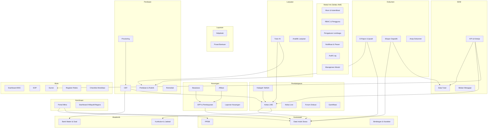
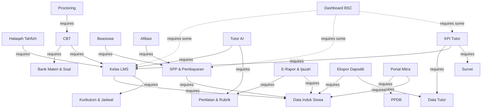

# DOKUMEN RANCANGAN IMPLEMENTASI TEKNIS (TECHNICAL IMPLEMENTATION PLAN)
## SISTEM INFORMASI TERPADU PKBM DIGITAL DAR EL IMAN
### Cetak Biru Arsitektur Sistem, Basis Data, Keamanan, Integrasi, dan Roadmap Pengembangan (2027 – 2032)

---

| Informasi Dokumen | Spesifikasi |
|---|---|
| **Inisiatif Sistem** | Platform PKBM Digital Terpadu Dar El Iman |
| **Institusi Pemilik** | Yayasan Dar El Iman Padang |
| **Jenis Dokumen** | Dokumen Arsitektur & Rencana Implementasi Teknis (Master Technical Blueprint) |
| **Versi Dokumen** | 1.0 — Komprehensif & Siap Presentasi Eksekutif |
| **Target Pembaca** | Dewan Pembina, Dewan Direksi/Pimpinan Yayasan, Tim Pengarah IT, dan Tim Pengembang Sistem |
| **Cakupan Waktu** | Master Plan 2027 – 2032 (Fase Alpha, Beta, Ekspansi, hingga Advanced) |

---

### Ringkasan Eksekutif (Executive Summary)

Dokumen ini merupakan **Cetak Biru dan Rencana Implementasi Teknis (Technical Implementation Plan)** komprehensif untuk pembangunan **Sistem Informasi Terpadu PKBM Digital Dar El Iman**. Sistem ini dirancang untuk mendigitalkan seluruh ekosistem pendidikan non-formal (kesetaraan Paket A, Paket B, dan Paket C) yang diperkuat dengan nilai-nilai kepesantrenan, tahfizh Al-Qur'an, dan pembinaan karakter Islami di bawah naungan Yayasan Dar El Iman. Platform ini ditujukan untuk melayani peserta didik reguler di seluruh Indonesia maupun komunitas santri diaspora di berbagai belahan dunia lintas zona waktu (*multi-timezone*).

Arsitektur sistem yang direkomendasikan mengadopsi pola **Modular Monolith** berkinerja tinggi dengan backend berbasis **Go (Golang)**, basis data relasional andal **PostgreSQL**, sistem antrean dan caching in-memory cepat **Redis**, serta arsitektur antarmuka modern yang *fully decoupled* (API-First). Pilihan arsitektur ini memberikan efisiensi komputasi maksimal, kemudahan pemeliharaan (*maintainability*), serta skalabilitas jangka panjang tanpa kompleksitas operasional microservices yang berlebihan di fase awal.

Seluruh kebutuhan sistem mencakup **41 modul fungsional** yang terbagi dalam 5 pilar strategis:
1. **PPDB & Kesiswaan**: Penerimaan santri baru bertingkat, data induk santri, hingga bimbingan konseling dan karakter.
2. **Akademik & Pembelajaran (LMS)**: Manajemen kurikulum kesetaraan, bank materi, kelas virtual, hingga halaqah tahfizh interaktif.
3. **Penilaian, Ujian (CBT) & Dokumen**: Asesmen berbasis rubrik, Computer-Based Test dengan sistem proctoring, remedial otomatis, e-rapor, penerbitan ijazah ber-QR code, dan arsip digital.
4. **Keuangan & Kemitraan**: Manajemen SPP, pembayaran multi-channel, donasi/beasiswa, afiliasi, serta portal kemitraan dan dashboard komunitas wilayah/negara.
5. **Tata Kelola Mutu & Manajemen Sistem**: Monitoring Balanced Scorecard (BSC), standar operasional prosedur (SOP), audit trail, register risiko, checklist akreditasi BAN-PDM, dan sinkronisasi data Dapodik Kemendikbudristek.

Keamanan sistem diperkuat dengan **Role-Based Access Control (RBAC) 4-Layer**, perlindungan data pribadi sesuai amanat **UU No. 27/2022 tentang Perlindungan Data Pribadi (UU PDP)**, enkripsi data sensitif, serta audit log mutlak (*tamper-evident*).

---

## Daftar Isi

1. [Landasan Sistem & Ruang Lingkup Fungsional](#1-landasan-sistem--ruang-lingkup-fungsional)
2. [Prinsip Rekayasa Sistem & Kerangka Pengambilan Keputusan](#2-prinsip-rekayasa-sistem--kerangka-pengambilan-keputusan)
3. [Gambaran Umum Sistem (System Overview)](#3-gambaran-umum-sistem-system-overview)
4. [Rekomendasi Arsitektur Sistem (Modular Monolith)](#4-rekomendasi-arsitektur-sistem-modular-monolith)
5. [Arsitektur Backend Berbasis Go](#5-arsitektur-backend-berbasis-go)
6. [Arsitektur Frontend & Pengalaman Pengguna](#6-arsitektur-frontend--pengalaman-pengguna)
7. [Desain Basis Data & Skema Konseptual ERD](#7-desain-basis-data--skema-konseptual-erd)
8. [Arsitektur & Dekomposisi 41 Modul Fungsional](#8-arsitektur--dekomposisi-41-modul-fungsional)
9. [Matriks Ketergantungan Antar-Modul (Module Dependency)](#9-matriks-ketergantungan-antar-modul-module-dependency)
10. [Sistem Manajemen Modul (Module Manager & Feature Flagging)](#10-sistem-manajemen-modul-module-manager--feature-flagging)
11. [Autentikasi, Keamanan Akun & RBAC 4-Layer](#11-autentikasi-keamanan-akun--rbac-4-layer)
12. [Arsitektur API & Komunikasi Antar-Komponen](#12-arsitektur-api--komunikasi-antar-komponen)
13. [Keamanan Siber, Kepatuhan Regulasi & Privasi Data](#13-keamanan-siber-kepatuhan-regulasi--privasi-data)
14. [Skalabilitas Internasional & Pengelolaan Multi-Timezone](#14-skalabilitas-internasional--pengelolaan-multi-timezone)
15. [Integrasi Eksternal & Ekspor Data Dapodik](#15-integrasi-eksternal--ekspor-data-dapodik)
16. [Roadmap Implementasi Bertahap (2027 – 2032)](#16-roadmap-implementasi-bertahap-2027--2032)
17. [Ruang Lingkup Minimum Viable Product (MVP)](#17-ruang-lingkup-minimum-viable-product-mvp)
18. [Strategi Pengujian Kualitas Sistem (Testing Strategy)](#18-strategi-pengujian-kualitas-sistem-testing-strategy)
19. [Infrastruktur, Deployment & Operasional Cloud](#19-infrastruktur-deployment--operasional-cloud)
20. [Manajemen Risiko Teknis & Rencana Mitigasi](#20-manajemen-risiko-teknis--rencana-mitigasi)
21. [Poin Keputusan Strategis Pimpinan & Dewan Pengurus](#21-poin-keputusan-strategis-pimpinan--dewan-pengurus)
22. [Rekomendasi Final & Langkah Tindak Lanjut](#22-rekomendasi-final--langkah-tindak-lanjut)

---

## 1. Landasan Sistem & Ruang Lingkup Fungsional

Pengembangan Platform PKBM Digital Dar El Iman didasarkan pada dokumen strategis *Master Plan Rancangan Fitur Aplikasi PKBM Digital Dar El Iman 2027–2032*. Sistem ini memosisikan seluruh kebutuhan operasional, manajerial, kepesantrenan, dan regulasi pendidikan sebagai fondasi utama perancangan teknis.

Sistem dirancang secara komprehensif untuk mencakup seluruh pilar fungsional berikut:

| Pilar Sistem | Ruang Lingkup dan Kemampuan Utama |
|---|---|
| **Fondasi Arsitektural** | Arsitektur modular berbasis modul independen yang dapat diaktifkan/dinonaktifkan secara dinamis (*dynamic feature flagging*), validasi dependensi modul otomatis, isolasi data, dan konfigurasi fleksibel per institusi/cabang. |
| **Tata Kelola Pengguna & Hak Akses** | Dukungan seluruh peran pengguna (Dewan Pembina, Direktur, Para Manajer Bidang, Tutor, Wali Kelas, Proktor Ujian, Staf Administrasi, Helpdesk, Tim Penjamin Mutu, Santri, Orang Tua/Wali, Koordinator Mitra Daerah/Luar Negeri, dan Donatur). Didukung sistem multi-role, RBAC 4 layer, delegasi akses sementara (*temporary delegation*), mekanisme *maker-checker*, *approval workflow*, dan pencatatan audit log komprehensif. |
| **Fondasi Sistem Inti** | Modul Akun & Autentikasi, RBAC & Otorisasi, Pengaturan Kelembagaan, Layanan Notifikasi & Olah Pesan Multi-Channel, Audit Trail Sistem, serta Manajemen Modul Terpusat. |
| **Kesiswaan, Akademik & LMS** | PPDB Online bertingkat, Data Induk Santri, Bimbingan Konseling & Karakter, Manajemen Kurikulum & Kalender Akademik, Bank Materi & Butir Soal, Kelas Virtual LMS, Kelas Tatap Muka Virtual (Live), Halaqah Tahfizh Interaktif dengan rekaman setoran hafalan, Forum Diskusi Terbimbing, serta Gamifikasi Pembelajaran. |
| **Asesmen, Ujian & Dokumen** | Manajemen Penilaian & Rubrik Capaian Kompetensi, Computer-Based Test (CBT) berkapasitas tinggi dengan *anti-cheat / activity logging proctoring*, Remedial Terjadwal Otomatis, Penerbitan E-Rapor & Ijazah Terverifikasi QR Code anti-pemalsuan, Ekspor Standar Dapodik Kemendikbudristek, dan Arsip Dokumen Digital Terenkripsi. |
| **Keuangan, Kemitraan & Mutu** | Tagihan SPP & Pembayaran Multi-Channel, Pengelolaan Beasiswa & Donatur, Sistem Referral Afiliasi, Laporan Keuangan Real-Time, Portal Mitra Lembaga & Luar Negeri, Dashboard Pemantauan Wilayah/Diaspora, Pengelolaan Beban Ajar & Kinerja Tutor, Dashboard Eksekutif Balanced Scorecard (BSC), Repositori SOP Terpadu, Survei Kepuasan Digital, Register Risiko Mutu, dan Checklist Akreditasi BAN-PDM. |
| **Jangkauan Global & AI** | Layanan ramah diaspora dengan penanganan multi-zona waktu (*multi-timezone*), direktori komunitas diaspora dan KBRI, integrasi kecerdasan buatan (*AI Tutor Assistant*), serta analitik prediktif performa santri. |

Seluruh spesifikasi di atas dirancang untuk menjamin keselarasan antara visi dakwah pendidikan Yayasan Dar El Iman dengan kepatuhan hukum dan regulasi pendidikan nasional.

---

## 2. Prinsip Rekayasa Sistem & Kerangka Pengambilan Keputusan

Dalam penyusunan rencana implementasi ini, seluruh aspek teknis diklasifikasikan ke dalam 4 kerangka kerja baku:

| Kategori Kerangka Kerja | Definisi dan Peran dalam Implementasi |
|---|---|
| **Kebutuhan Wajib Sistem** | Spesifikasi fungsional, alur kerja bisnis lembaga, dan regulasi pemerintah yang menjadi sasaran utama sistem. |
| **Rekomendasi Arsitektural** | Solusi teknis dan pola desain rekayasa perangkat lunak (*software engineering best practices*) yang diusulkan untuk menjamin performa tinggi, keamanan, keandalan, dan efisiensi biaya infrastruktur. |
| **Asumsi Operasional** | Parameter dasar operasional (seperti estimasi beban kerja puncak, volume data, bandwidth jaringan di daerah santri) yang menjadi acuan perhitungan kapasitas teknis. |
| **Poin Keputusan Strategis** | Kebijakan institusional atau pertimbangan manajerial yang memerlukan arahan dan pengesahan resmi dari Dewan Pembina dan Direksi Yayasan sebelum pengembangan teknis pada modul terkait dimulai. |

Prinsip utama yang dipegang adalah: **Kebutuhan fungsional dan integritas pendidikan Dar El Iman merupakan prioritas tertinggi**, sedangkan pendekatan teknologi dipilih secara cermat agar memberikan fondasi yang kokoh, terukur, dan aman untuk jangka panjang.

---

## 3. Gambaran Umum Sistem (System Overview)

### 3.1 Tujuan Sistem

> **Kebutuhan Fungsional Sistem:**
> Membangun aplikasi digital terpadu untuk PKBM (Pusat Kegiatan Belajar Masyarakat) Dar El Iman yang mencakup lima area fungsional utama: PPDB dan kesiswaan, akademik dan pembelajaran, penilaian dan dokumen, keuangan dan mitra, serta manajemen mutu dan sistem. Sistem dirancang modular dan dikembangkan bertahap sesuai roadmap 2027–2032.

### 3.2 Karakteristik Sistem

Berdasarkan analisis requirement, sistem ini memiliki karakteristik berikut:

| Karakteristik | Penjelasan |
|---|---|
| **Multi-tenant potential** | Dokumen menyebutkan kemungkinan replikasi untuk cabang/mitra dengan modul berbeda per lembaga |
| **Multi-role** | Satu pengguna bisa memiliki lebih dari satu role secara bersamaan |
| **Multi-jenjang** | Mendukung Paket A, B, dan C (setara SD, SMP, SMA) |
| **Multi-timezone** | Peserta didik dari berbagai negara dengan zona waktu berbeda |
| **Long-lifecycle data** | Data akademik, nilai, rapor, ijazah harus disimpan dan dapat diakses dalam jangka panjang |
| **Regulatory compliance** | Harus kompatibel dengan format Dapodik dan standar akreditasi |
| **Modular deployment** | Modul dapat diaktifkan/dinonaktifkan secara independen dengan validasi dependency |

### 3.3 Jenis Pengguna

> **Kebutuhan Fungsional Sistem:**
> Berdasarkan Dokumen Master Plan PKBM Digital Dar El Iman:

```
┌─────────────────────────────────────────────────────────────┐
│                      PENGGUNA SISTEM                        │
├──────────────┬──────────────────────────────────────────────┤
│ Pimpinan     │ Super Admin                                  │
│              │ Dewan Pembina (read-only)                    │
│              │ Direktur PKBM                                │
├──────────────┼──────────────────────────────────────────────┤
│ Manajerial   │ Manajer Akademik                             │
│              │ Manajer Kesiswaan & Layanan Internasional    │
│              │ Manajer Keuangan & Legal                     │
│              │ Manajer Teknologi                            │
├──────────────┼──────────────────────────────────────────────┤
│ Operasional  │ Tutor/Pendidik                               │
│              │ Wali Kelas/Pendamping                        │
│              │ Proktor Ujian                                │
│              │ Staf Administrasi/Operator Dapodik           │
│              │ Staf Helpdesk                                │
│              │ Tim Mutu                                     │
├──────────────┼──────────────────────────────────────────────┤
│ Pengguna     │ Siswa                                        │
│ Layanan      │ Orang Tua/Wali                               │
├──────────────┼──────────────────────────────────────────────┤
│ Eksternal    │ Koordinator Mitra                            │
│              │ Donatur/Pemberi Beasiswa (opsional)          │
└──────────────┴──────────────────────────────────────────────┘
```

**Total: 17 role** yang sudah teridentifikasi, dengan kemungkinan role kustom tambahan yang dibuat Super Admin.

### 3.4 Skala dan Pertumbuhan

> **Asumsi Operasional:**
> Dokumen stakeholder tidak menyebutkan angka spesifik jumlah pengguna. Berdasarkan konteks PKBM dengan dukungan diaspora internasional:

| Parameter | Estimasi Awal (Alpha) | Estimasi Pertumbuhan (2030+) |
|---|---|---|
| Siswa aktif | 100 – 500 | 1.000 – 5.000+ |
| Tutor/pendidik | 10 – 30 | 50 – 100+ |
| Mitra | 5 – 10 | 20 – 50+ |
| Concurrent users | 50 – 100 | 500 – 1.000 |
| Concurrent CBT takers | — | 100 – 500 |

> **Poin Keputusan Manajemen:**
> Stakeholder perlu mengkonfirmasi estimasi jumlah pengguna aktual untuk menentukan sizing infrastruktur.

### 3.5 Modul Utama dan Hubungan Antar-Modul

> **Kebutuhan Fungsional Sistem:**
> Sistem terdiri dari **6 modul inti** (selalu aktif) dan **~30 modul bisnis** (dapat diaktifkan/dinonaktifkan) yang dikelompokkan ke dalam 11 kelompok. Hubungan antar-modul bersifat **read-only dependency**: modul yang bergantung pada modul lain hanya membaca datanya, tidak mengubah.



### 3.6 Kebutuhan Non-Functional

| Kategori | Kebutuhan | Sumber |
|---|---|---|
| **Scalability** | Mendukung pertumbuhan dari ratusan ke ribuan siswa; multi-mitra; multi-negara | Kebutuhan Sistem — replikasi untuk cabang/mitra |
| **Maintainability** | Modular — modul bisa dikembangkan, diganti, atau dinonaktifkan tanpa mempengaruhi modul lain | Kebutuhan Sistem — prinsip modular #5 |
| **Security** | Hak akses data sensitif lebih ketat untuk data anak, dokumen identitas, dan data keuangan | Kebutuhan Sistem — aturan RBAC #4 |
| **Availability** | Sistem harus dapat diakses oleh siswa internasional di berbagai zona waktu (24/7 untuk konten asinkron) | Kebutuhan Sistem — kebutuhan diaspora |
| **Auditability** | Audit log untuk semua perubahan nilai, data siswa, keuangan, dan hak akses | Kebutuhan Sistem — aturan RBAC #5 |
| **Data Longevity** | Data akademik (nilai, rapor, ijazah) harus tersimpan jangka panjang, bahkan jika modul dinonaktifkan | Kebutuhan Sistem — prinsip modular #3 |
| **Regulatory** | Kompatibilitas format Dapodik; standar akreditasi; kemungkinan ISO 21001 | Kebutuhan Sistem — roadmap |
| **Performance** | CBT harus mampu menangani ujian bersamaan dengan proctoring real-time | Rekomendasi Arsitektural — implikasi dari CBT + Proctoring |

---

## 4. Rekomendasi Arsitektur Sistem (Modular Monolith)

### 4.1 Evaluasi Pendekatan

| Pendekatan | Kelebihan untuk Konteks Ini | Kekurangan untuk Konteks Ini |
|---|---|---|
| **Modular Monolith** | Boundary modul jelas tanpa overhead jaringan; transaksi lintas modul mudah; deployment sederhana; tim kecil bisa mengelola; refactor ke microservices di masa depan tetap mungkin | Scaling harus seluruh aplikasi (bukan per modul); risiko coupling meningkat jika tidak disiplin |
| **Microservices** | Scaling per modul; deployment independen; isolasi kegagalan | Overhead infrastruktur besar (service mesh, API gateway, distributed tracing); data consistency kompleks; development cost tinggi; membutuhkan tim yang besar dan berpengalaman |
| **Serverless / FaaS** | Auto-scaling; bayar per penggunaan | Vendor lock-in; cold start; tidak cocok untuk stateful operations seperti CBT/proctoring; kompleksitas debugging |

### 4.2 Rekomendasi: Modular Monolith

> **Rekomendasi Arsitektural:**
> Arsitektur yang direkomendasikan adalah **Modular Monolith** dengan alasan:

1. **Sesuai dengan prinsip modular stakeholder.** Dokumen menginginkan modul yang berdiri sendiri dengan boundary jelas, tetapi juga menginginkan dependency antar-modul yang terkelola (contoh: Rapor membaca nilai dari Penilaian). Modular monolith memenuhi kedua kebutuhan ini tanpa overhead distributed system.

2. **Ukuran tim dan timeline.** Dengan roadmap 5 tahun dan pengembangan bertahap, diasumsikan tim development tidak besar. Modular monolith lebih realistis untuk tim 3–10 developer dibanding microservices.

3. **Data consistency.** Banyak operasi membutuhkan konsistensi lintas modul (contoh: approval workflow yang melibatkan nilai → rapor → ijazah). Database transaction dalam satu proses jauh lebih sederhana dan reliable dibanding distributed transaction.

4. **Module enable/disable.** Requirement ini lebih mudah diimplementasikan sebagai configuration/feature flag dalam satu codebase dibanding meng-orchestrate deployment/undeployment service terpisah.

5. **Jalur evolusi.** Jika di masa depan (2030+) satu modul membutuhkan scaling independen (misalnya CBT saat ujian massal), modul tersebut bisa diekstrak menjadi service terpisah karena boundary-nya sudah jelas sejak awal.

### 4.3 Batas Modul dalam Modular Monolith

> **Rekomendasi Arsitektural:**
> Setiap modul diimplementasikan sebagai **Go package/directory terpisah** dengan aturan:

```
┌──────────────────────────────────────────────────┐
│                APPLICATION BINARY                │
│                                                  │
│  ┌────────────┐  ┌────────────┐  ┌────────────┐ │
│  │  Module A   │  │  Module B   │  │  Module C   │ │
│  │            │  │            │  │            │ │
│  │ - Handler  │  │ - Handler  │  │ - Handler  │ │
│  │ - Service  │  │ - Service  │  │ - Service  │ │
│  │ - Repo     │  │ - Repo     │  │ - Repo     │ │
│  │ - Domain   │  │ - Domain   │  │ - Domain   │ │
│  │ - Perms    │  │ - Perms    │  │ - Perms    │ │
│  └─────┬──────┘  └─────┬──────┘  └─────┬──────┘ │
│        │               │               │        │
│  ┌─────▼───────────────▼───────────────▼──────┐ │
│  │          Shared Kernel / Internal API        │ │
│  │  (module registry, auth context, events)     │ │
│  └─────────────────────┬───────────────────────┘ │
│                        │                         │
│  ┌─────────────────────▼───────────────────────┐ │
│  │              Infrastructure Layer            │ │
│  │   (database, cache, storage, queue, logger)  │ │
│  └──────────────────────────────────────────────┘ │
└──────────────────────────────────────────────────┘
```

**Aturan boundary:**
- Modul **tidak boleh** mengakses repository/database table modul lain secara langsung.
- Komunikasi antar-modul melalui **service interface** yang didefinisikan di shared kernel.
- Setiap modul mendaftarkan dirinya (routes, permissions, settings) ke **module registry** saat startup.
- Modul yang dinonaktifkan: registry-nya tidak dimuat, route tidak terdaftar, permission tidak tersedia, tetapi data di database tetap utuh.

### 4.4 Concern Teknis

> [!WARNING]
> **Risiko coupling di modular monolith**: Tanpa disiplin, developer bisa langsung mengimpor internal package modul lain dan membuat tight coupling. Mitigasi: gunakan linter/build constraint yang melarang import lintas modul kecuali melalui interface yang didefinisikan di shared kernel. Pertimbangkan tools seperti `go-cleanarch` atau custom linting rules.

---

## 5. Arsitektur Backend Berbasis Go

### 5.1 Justifikasi Go

> **Kebutuhan Fungsional Sistem:**
> Stakeholder menginginkan Go sebagai backend, dengan pertimbangan efisiensi dan skalabilitas.

> **Rekomendasi Arsitektural:**
> Go memang sesuai untuk konteks ini:
- **Concurrency model** (goroutines) cocok untuk menangani concurrent CBT/exam sessions dan live class coordination.
- **Single binary deployment** menyederhanakan deployment modular monolith.
- **Strong typing + compile-time checks** mengurangi runtime errors di sistem yang kompleks.
- **Performa** memadai untuk kebutuhan skala yang diproyeksikan.
- **Standard library** sudah cukup kuat untuk HTTP server, JSON, crypto, tanpa harus bergantung pada banyak library eksternal.

### 5.2 Framework / HTTP Stack

> **Rekomendasi Arsitektural:**
> Evaluasi:

| Opsi | Pertimbangan |
|---|---|
| **`net/http` (stdlib)** | Paling stabil; sudah sangat capable sejak Go 1.22+ dengan pattern matching di `ServeMux`; tidak ada dependency eksternal; tetapi perlu menulis middleware dan helper sendiri |
| **Chi** | Lightweight router di atas `net/http`; kompatibel penuh dengan `net/http` handler; middleware chaining yang baik; sudah mature dan well-maintained |
| **Echo / Gin** | Full-featured framework; built-in validation, binding, middleware; tetapi membawa opinionated structure dan abstraksi yang belum tentu dibutuhkan |
| **Fiber** | Performa tinggi (berbasis fasthttp); tetapi tidak kompatibel dengan `net/http` ecosystem — ini masalah besar untuk jangka panjang |

**Rekomendasi: `net/http` stdlib + Chi router**

Alasan:
1. Chi adalah **thin wrapper** di atas `net/http` — semua handler tetap `http.Handler` standar, sehingga tidak ada vendor lock-in.
2. Fitur routing (URL params, middleware groups, subrouter) cukup untuk kebutuhan modular routing yang kompleks.
3. Setiap modul bisa mendaftarkan subrouter-nya sendiri ke router utama.
4. Jika di masa depan Chi dihentikan, migrasi ke stdlib murni atau router lain sangat mudah karena interface-nya kompatibel.

> **Poin Keputusan Manajemen:**
> Konfirmasi stakeholder apakah ada preferensi framework lain atau keputusan ini bisa dilanjutkan.

### 5.3 Project Structure

> **Rekomendasi Arsitektural:**
> Struktur directory mengikuti prinsip modular monolith:

```
pkbm-server/
├── cmd/
│   └── server/
│       └── main.go                  # Entry point, wire modules, start server
├── internal/
│   ├── platform/                    # Infrastructure/cross-cutting concerns
│   │   ├── auth/                    # Authentication (JWT, session, 2FA)
│   │   ├── rbac/                    # RBAC engine (permission evaluation)
│   │   ├── database/                # DB connection, migration runner
│   │   ├── storage/                 # File storage abstraction
│   │   ├── notification/            # Notification dispatcher
│   │   ├── audit/                   # Audit log writer
│   │   ├── config/                  # Configuration loader
│   │   ├── middleware/              # Shared HTTP middleware
│   │   ├── validation/              # Shared validation helpers
│   │   ├── errors/                  # Error types and handling
│   │   ├── pagination/              # Pagination helpers
│   │   ├── logger/                  # Structured logging
│   │   └── jobs/                    # Background job runner
│   ├── kernel/                      # Shared kernel
│   │   ├── module.go                # Module interface & registry
│   │   ├── events.go                # Internal event bus
│   │   └── types.go                 # Shared value objects (UserID, etc.)
│   └── modules/                     # Business modules
│       ├── account/                 # Akun & Autentikasi
│       │   ├── handler.go           # HTTP handlers
│       │   ├── service.go           # Business logic
│       │   ├── repository.go        # Data access
│       │   ├── domain.go            # Domain types
│       │   ├── permissions.go       # Module permission definitions
│       │   └── module.go            # Module registration
│       ├── user_rbac/               # RBAC & Pengguna
│       ├── institution/             # Pengaturan Lembaga
│       ├── notification/            # Notifikasi & Pesan
│       ├── audit_log/               # Audit Log
│       ├── module_manager/          # Manajemen Modul
│       ├── ppdb/                    # PPDB
│       ├── student/                 # Data Induk Siswa
│       ├── counseling/              # Bimbingan & Karakter
│       ├── curriculum/              # Kurikulum & Jadwal
│       ├── content_bank/            # Bank Materi & Soal
│       ├── lms/                     # Kelas LMS
│       ├── live_class/              # Kelas Live
│       ├── tahfizh/                 # Halaqah Tahfizh
│       ├── forum/                   # Forum Diskusi
│       ├── gamification/            # Gamifikasi
│       ├── assessment/              # Penilaian & Rubrik
│       ├── cbt/                     # CBT
│       ├── proctoring/              # Proctoring
│       ├── remedial/                # Remedial
│       ├── report_card/             # E-Rapor & Ijazah
│       ├── dapodik/                 # Ekspor Dapodik
│       ├── document_archive/        # Arsip Dokumen
│       ├── finance/                 # SPP & Pembayaran
│       ├── scholarship/             # Beasiswa
│       ├── affiliate/               # Afiliasi
│       ├── finance_report/          # Laporan Keuangan
│       ├── partner/                 # Portal Mitra
│       ├── region_dashboard/        # Dashboard Wilayah/Negara
│       ├── tutor/                   # Data Tutor
│       ├── workload/                # Beban Mengajar
│       ├── tutor_kpi/               # KPI & Kinerja
│       ├── bsc/                     # Dashboard BSC
│       ├── sop/                     # SOP
│       ├── survey/                  # Survei
│       ├── risk_register/           # Register Risiko
│       ├── accreditation/           # Checklist Akreditasi
│       ├── helpdesk/                # Helpdesk
│       ├── help_center/             # Pusat Bantuan
│       ├── ai_tutor/                # Tutor AI
│       └── analytics/               # Analitik Lanjutan
├── migrations/                      # Database migration files
├── docs/                            # API documentation
├── configs/                         # Configuration files
├── scripts/                         # Build/deploy scripts
├── go.mod
└── go.sum
```

### 5.4 Module Interface Pattern

> **Rekomendasi Arsitektural:**
> Setiap modul mengimplementasikan interface standar:

```go
// internal/kernel/module.go

type Module interface {
    // ID unik modul
    ID() string
    // Nama untuk ditampilkan
    Name() string
    // Daftar modul yang dibutuhkan (dependency)
    Dependencies() []string
    // Apakah modul inti (tidak bisa dinonaktifkan)
    IsCore() bool
    // Daftarkan routes ke router
    RegisterRoutes(r chi.Router)
    // Daftarkan permission definitions
    Permissions() []Permission
    // Daftarkan pengaturan default modul
    DefaultSettings() []Setting
    // Hook untuk inisialisasi saat modul diaktifkan
    OnEnable(ctx context.Context) error
    // Hook untuk cleanup saat modul dinonaktifkan
    OnDisable(ctx context.Context) error
}
```

### 5.5 Komponen Teknis Backend

| Komponen | Rekomendasi | Alasan |
|---|---|---|
| **Routing** | Chi subrouter per modul | Setiap modul mendaftarkan route group sendiri; module manager bisa skip registrasi modul yang disabled |
| **Middleware** | Chain: request ID → logger → recover → CORS → rate limit → auth → RBAC → audit | Urutan penting; auth dan RBAC harus sebelum handler; audit log setelah response |
| **Validation** | `go-playground/validator` + custom validators | Mature, tag-based; mudah untuk custom rules (misal: validasi NIS, format tanggal hijriah) |
| **Error Handling** | Custom error types dengan error code + HTTP status mapping | Konsisten untuk API response; mendukung i18n error messages di masa depan |
| **Authentication** | JWT (access token) + opaque refresh token di database | Stateless access token untuk performa; refresh token di DB untuk revocation; lihat Bagian 11 |
| **Authorization** | RBAC engine di middleware, per-request evaluation | Evaluasi 4 layer (module → feature → action → scope) per request; lihat Bagian 11 |
| **Database Access** | `pgx` (PostgreSQL driver) + `sqlc` (type-safe SQL) | `pgx` adalah driver PostgreSQL paling performant di Go; `sqlc` menghasilkan Go code dari SQL — type-safe tanpa overhead ORM |
| **Transaction** | `pgx` transaction + repository pattern per module | Transaksi di service layer; satu transaksi per use case yang membutuhkan atomicity |
| **Background Jobs** | In-process worker pool (awal) → message queue (jika dibutuhkan) | Awal: goroutine pool dengan `errgroup` untuk email, notifikasi, PDF generation. Evolusi: jika volume besar, tambahkan queue (lihat di bawah) |
| **Queue** | Keputusan Manajemen Diperlukan | Belum dibutuhkan di Alpha. Jika dibutuhkan: PostgreSQL-based queue (seperti `pgq` atau `river`) untuk menghindari infrastruktur tambahan (Redis/RabbitMQ). Keputusan ditunda sampai Beta. |
| **Caching** | Application-level in-memory cache (awal) → Redis (jika skala meningkat) | Cache permission matrix, module status, dan institution settings. Awal: `sync.Map` atau `groupcache`. Redis ditambahkan jika ada kebutuhan shared cache di multiple instance. |
| **Logging** | `log/slog` (stdlib Go 1.21+) | Structured logging bawaan Go; output JSON untuk production; mudah diintegrasikan dengan log aggregator |
| **Configuration** | Environment variables + config file (YAML/TOML) | 12-factor app; env vars untuk secrets; config file untuk default settings |
| **API Versioning** | URL path prefix (`/api/v1/...`) | Sederhana; jelas; mudah di-route per versi |
| **Observability** | OpenTelemetry (traces + metrics) + structured logging | Standard industri; vendor-agnostic; bisa diarahkan ke berbagai backend (Jaeger, Prometheus, etc.) |

### 5.6 Concern dan Trade-off

> [!NOTE]
> **Mengapa `sqlc` bukan ORM (GORM, ent)?**
> Sistem ini memiliki query yang kompleks (RBAC scope filtering, multi-join untuk rapor, aggregate untuk dashboard BSC). ORM cenderung menghasilkan query yang tidak optimal untuk kasus-kasus ini dan memaksa developer berpikir dalam abstraksi ORM alih-alih SQL yang sebenarnya. `sqlc` memberikan type safety dengan kontrol penuh atas SQL. Trade-off: developer harus menulis SQL sendiri, tetapi ini justru diinginkan untuk query kompleks.

> [!NOTE]
> **Mengapa belum memilih Redis/message queue di awal?**
> Prinsip: jangan menambahkan infrastruktur sebelum ada kebutuhan nyata. Untuk Alpha (2027), volume notifikasi dan background job kemungkinan masih bisa ditangani goroutine pool. Infrastruktur tambahan menambah complexity operasional yang belum justified.


---

## 6. Arsitektur Frontend & Pengalaman Pengguna

### 6.1 Pendekatan Umum

Antarmuka pengguna (Frontend) dirancang terpisah secara penuh (*fully decoupled*) dari backend melalui pendekatan API-First. Perancangan antarmuka (UI/UX), prototipe interaktif, dan design system dikembangkan secara independen menggunakan standar modern sebelum diintegrasikan dengan API backend Go.

> **Rekomendasi Arsitektural:**
> Frontend direkomendasikan sebagai **Single Page Application (SPA)** yang berkomunikasi dengan Go backend melalui REST API.

Alasan:
- Pemisahan frontend/backend memungkinkan pengembangan paralel.
- SPA memberikan pengalaman yang responsif untuk LMS, dashboard, dan CBT.
- Go backend hanya menyajikan API, tidak meng-generate HTML — sesuai dengan prinsip separation of concerns.

> **Poin Keputusan Manajemen:**
> Teknologi frontend belum ditentukan. Opsi yang layak dipertimbangkan:

| Opsi | Pertimbangan |
|---|---|
| **Next.js (React)** | SSR/SSG untuk SEO (halaman publik PPDB); ekosistem besar; TypeScript first-class |
| **Nuxt (Vue)** | Kurva belajar lebih rendah; template-based yang lebih familiar untuk tim yang belum berpengalaman |
| **SvelteKit** | Performa ringan; bundle size kecil (penting untuk siswa di daerah 3T dengan koneksi terbatas) |

Keputusan final bergantung pada kapabilitas tim frontend.

### 6.2 Frontend — Backend Communication

```
┌──────────────┐          HTTPS/REST          ┌──────────────┐
│              │  ─────────────────────────►   │              │
│   Frontend   │  ◄─────────────────────────   │  Go Backend  │
│   (SPA)      │       JSON Response          │  (API)       │
│              │                              │              │
│              │  ──── WebSocket (opsional) ── │              │
│              │  (notifikasi real-time,       │              │
│              │   live class sync,            │              │
│              │   proctoring stream)          │              │
└──────────────┘                              └──────────────┘
```

### 6.3 Aspek Teknis Frontend

| Aspek | Pendekatan |
|---|---|
| **Authentication Flow** | Frontend menyimpan JWT access token di memory (bukan localStorage); refresh token via httpOnly cookie; silent refresh sebelum token expire |
| **Authorization** | Backend mengirimkan daftar permission user saat login; frontend menyembunyikan menu/tombol yang tidak diizinkan; **enforcement tetap di backend** — frontend hanya UX optimization |
| **API Consumption** | HTTP client wrapper dengan interceptor untuk: token attachment, refresh on 401, error normalization, retry logic |
| **State Management** | Server state (data dari API): library seperti TanStack Query / SWR. Client state (UI state): framework built-in state management. Hindari menggandakan server data di client store. |
| **File Upload** | Multipart upload langsung ke backend API; backend meneruskan ke storage layer; untuk file besar (video materi): presigned URL upload jika menggunakan object storage |
| **Notifications** | Polling atau WebSocket untuk notifikasi real-time; fallback ke polling jika WebSocket tidak tersedia |
| **Error Handling** | Standarisasi error response dari backend (lihat Bagian 12); frontend menampilkan pesan error yang user-friendly; error boundary untuk crash recovery |
| **Responsive Behavior** | Mobile-first design; siswa diaspora mungkin mengakses dari smartphone; CBT harus usable di tablet; dashboard admin optimal di desktop |
| **Offline/Low Bandwidth** | Keputusan Manajemen Diperlukan — Apakah perlu mode offline untuk siswa di daerah 3T? Jika ya, perlu PWA strategy. Jika tidak, fokus pada optimasi loading (lazy loading, code splitting, CDN). |

### 6.4 Halaman Publik vs Halaman Terautentikasi

> **Rekomendasi Arsitektural:**
> Halaman publik (PPDB, informasi PKBM) sebaiknya server-rendered untuk SEO. Halaman terautentikasi (dashboard, LMS, CBT) sebagai SPA penuh. Ini bisa dicapai dengan framework seperti Next.js yang mendukung hybrid rendering.

---

## 7. Desain Basis Data & Skema Konseptual ERD

### 7.1 Database yang Direkomendasikan

> **Rekomendasi Arsitektural:**
> **PostgreSQL** sebagai database utama.

Alasan:
1. **ACID compliance** — Penting untuk transaksi keuangan (SPP, beasiswa), approval workflow, dan konsistensi data akademik.
2. **Rich data types** — `jsonb` untuk settings per modul, `timestamptz` untuk timezone support, `uuid` untuk primary key, array types.
3. **Row-Level Security (RLS)** — Bisa digunakan sebagai lapisan tambahan untuk RBAC data scope enforcement di level database.
4. **Mature ecosystem** — Tool migrasi, monitoring, backup/restore, replication — semuanya well-established.
5. **Full-text search** — Bawaan PostgreSQL cukup untuk kebutuhan pencarian di bank soal, materi, dan forum. Tidak perlu Elasticsearch di awal.
6. **Partitioning** — Table partitioning untuk data yang tumbuh besar (audit log, assessment results) tanpa perlu database terpisah.

> **Asumsi Operasional:**
> Tidak ada kebutuhan untuk NoSQL atau database lain di tahap awal. Jika di masa depan Tutor AI membutuhkan vector database, itu bisa ditambahkan sebagai database sekunder.

### 7.2 Prinsip Desain Database

| Prinsip | Penjelasan |
|---|---|
| **Schema per module group** | Gunakan PostgreSQL schemas untuk mengelompokkan tabel per domain (misal: `student.*`, `academic.*`, `finance.*`). Bukan schema per modul karena terlalu granular, tetapi per kelompok fungsional. |
| **Soft delete** | Semua entity utama menggunakan `deleted_at` timestamp, bukan hard delete. Kebutuhan Sistem: data tetap tersimpan saat modul dinonaktifkan. |
| **Versioning / History** | Untuk data yang membutuhkan audit trail (nilai, data siswa, keuangan): gunakan history table pattern (`_history` table) yang mencatat setiap perubahan beserta `changed_by`, `changed_at`, dan `change_reason`. |
| **UUID primary key** | Semua tabel menggunakan UUID v7 (time-sortable) sebagai primary key. Alasan: menghindari enumeration attack, aman untuk API exposure, tidak bocorkan informasi urutan. |
| **Timezone-aware** | Semua timestamp disimpan sebagai `timestamptz` (UTC). Konversi ke timezone lokal dilakukan di application layer atau frontend. |
| **Academic year scoping** | Tabel akademik (kelas, nilai, jadwal) selalu memiliki `academic_year_id` sebagai scope. Data historis tetap tersimpan dan queryable. |

### 7.3 Conceptual ERD — Entity Utama

Berikut adalah entity utama per domain beserta relasi konseptualnya. Ini bukan SQL implementation — ini adalah panduan untuk desain detail.

### Domain: Core System

| Entity | Deskripsi | Relasi Utama |
|---|---|---|
| `User` | Semua pengguna sistem | Has many `UserRole`, has one `UserProfile` |
| `Role` | Role dalam sistem | Has many `RolePermission`, has many `UserRole` |
| `Permission` | Definisi izin (module + feature + action + scope) | Belongs to `Module` |
| `RolePermission` | Mapping role ke permission | Belongs to `Role`, belongs to `Permission` |
| `UserRole` | Mapping user ke role (dengan `valid_from`, `valid_until` untuk temporary access) | Belongs to `User`, belongs to `Role` |
| `Module` | Definisi modul (ID, nama, status, versi, dependencies) | Has many `Permission`, has many `ModuleSetting` |
| `ModuleSetting` | Pengaturan per modul | Belongs to `Module` |
| `AuditLog` | Log perubahan | References `User`, polymorphic reference ke entity yang berubah |
| `Notification` | Notifikasi lintas modul | Belongs to `User`, references source module |
| `NotificationTemplate` | Template pesan | Belongs to `Module` |
| `InstitutionSetting` | Pengaturan lembaga (tahun ajaran, jenjang, parameter umum) | — |
| `AcademicYear` | Tahun ajaran | Has many scope references |

### Domain: Kesiswaan

| Entity | Deskripsi | Relasi Utama |
|---|---|---|
| `Registration` | Pendaftaran PPDB | Belongs to `User` (calon siswa/ortu/mitra), has many `RegistrationDocument` |
| `RegistrationDocument` | Dokumen pendaftaran yang diunggah | Belongs to `Registration` |
| `PlacementTest` | Tes penempatan | Belongs to `Registration` |
| `Student` | Data induk siswa | Belongs to `User`, has many `Enrollment`, has many `StudentDocument` |
| `StudentDocument` | Dokumen siswa (akta, ijazah sebelumnya, dll.) | Belongs to `Student` |
| `StudentStatus` | Riwayat status siswa (aktif, cuti, lulus, keluar) + tanggal efektif | Belongs to `Student` |
| `DiasporaData` | Data khusus diaspora (negara, timezone, kontak KBRI) | Belongs to `Student` |
| `Guardian` | Data orang tua/wali | Belongs to `User`, has many `GuardianStudent` |
| `GuardianStudent` | Relasi orang tua — anak | Belongs to `Guardian`, belongs to `Student` |
| `CounselingRecord` | Catatan bimbingan konseling dan pembinaan karakter | Belongs to `Student` |
| `StudyGroup` (Rombel) | Rombongan belajar | Belongs to `AcademicYear`, has many students |

### Domain: Akademik

| Entity | Deskripsi | Relasi Utama |
|---|---|---|
| `Curriculum` | Kurikulum (KOSP) | Has many `Subject` |
| `Subject` | Mata pelajaran | Belongs to `Curriculum`, has many `LearningObjective` |
| `LearningObjective` | Capaian pembelajaran | Belongs to `Subject` |
| `Schedule` | Jadwal pelajaran (dengan timezone info) | Belongs to `Subject`, belongs to `StudyGroup`, belongs to `Tutor` |
| `TutorAssignment` | Penugasan tutor ke kelas/mapel | Belongs to `Tutor`, belongs to `Subject`, belongs to `StudyGroup` |
| `ContentItem` | Materi (bank materi) — video, bacaan, file | Belongs to `Subject`, belongs to `Tutor` (pembuat) |
| `QuestionBankItem` | Bank soal | Belongs to `Subject`, has many `QuestionOption` |
| `QuestionOption` | Opsi jawaban soal | Belongs to `QuestionBankItem` |

### Domain: Pembelajaran (LMS)

| Entity | Deskripsi | Relasi Utama |
|---|---|---|
| `Classroom` | Ruang kelas virtual | Belongs to `Subject`, belongs to `StudyGroup`, belongs to `AcademicYear` |
| `ClassroomModule` | Modul dalam kelas (unit pembelajaran) | Belongs to `Classroom` |
| `Assignment` | Tugas/kuis | Belongs to `ClassroomModule` |
| `AssignmentSubmission` | Pengumpulan tugas | Belongs to `Assignment`, belongs to `Student` |
| `LearningPath` | Jalur belajar per siswa | Belongs to `Student`, belongs to `Classroom` |
| `StudentProgress` | Progres belajar | Belongs to `Student`, belongs to `ClassroomModule` |
| `LiveClassSession` | Sesi kelas sinkron | Belongs to `Classroom`, has many `LiveClassAttendance` |
| `LiveClassAttendance` | Presensi live class | Belongs to `LiveClassSession`, belongs to `Student` |
| `LiveClassRecording` | Rekaman live class | Belongs to `LiveClassSession` |
| `TahfizhEnrollment` | Pendaftaran halaqah tahfizh | Belongs to `Student` |
| `TahfizhDeposit` | Setoran hafalan | Belongs to `TahfizhEnrollment`, belongs to `Tutor` (penilai) |
| `TahfizhTarget` | Target dan progres hafalan | Belongs to `TahfizhEnrollment` |
| `MurajaahRecord` | Catatan murajaah | Belongs to `TahfizhEnrollment` |
| `ForumThread` | Thread diskusi | Belongs to `Classroom`, belongs to `User` |
| `ForumPost` | Posting di thread | Belongs to `ForumThread`, belongs to `User` |
| `GamificationPoint` | Poin gamifikasi | Belongs to `Student` |
| `Badge` | Lencana | — |
| `StudentBadge` | Lencana yang diperoleh siswa | Belongs to `Student`, belongs to `Badge` |
| `Streak` | Data streak belajar | Belongs to `Student` |

### Domain: Penilaian & Ujian

| Entity | Deskripsi | Relasi Utama |
|---|---|---|
| `Assessment` | Penilaian (formatif/sumatif) | Belongs to `Subject`, belongs to `Classroom` |
| `AssessmentRubric` | Rubrik penilaian | Belongs to `Assessment` |
| `Grade` | Nilai siswa | Belongs to `Student`, belongs to `Assessment` |
| `GradeApproval` | Approval workflow nilai (maker-checker) | Belongs to `Grade` |
| `Exam` | Ujian CBT | Belongs to `Subject`, has many `ExamQuestion` |
| `ExamQuestion` | Soal dalam ujian (dari bank soal + pengacakan) | Belongs to `Exam`, references `QuestionBankItem` |
| `ExamSession` | Sesi ujian siswa | Belongs to `Exam`, belongs to `Student` |
| `ExamAnswer` | Jawaban siswa | Belongs to `ExamSession`, belongs to `ExamQuestion` |
| `ProctorLog` | Log pengawasan ujian | Belongs to `ExamSession` |
| `ProctorViolation` | Penandaan pelanggaran | Belongs to `ExamSession`, belongs to `User` (proktor) |
| `RemedialAssignment` | Tugas remedial | Belongs to `Student`, belongs to `Assessment` |

### Domain: Dokumen

| Entity | Deskripsi | Relasi Utama |
|---|---|---|
| `ReportCard` | E-Rapor | Belongs to `Student`, belongs to `AcademicYear` |
| `ReportCardDetail` | Detail nilai dalam rapor | Belongs to `ReportCard`, references `Grade` |
| `Certificate` | Ijazah/sertifikat | Belongs to `Student`, has QR verification code |
| `CertificateApproval` | Approval workflow ijazah | Belongs to `Certificate` |
| `DapodikExport` | Log ekspor Dapodik | — |
| `DocumentArchive` | Arsip dokumen siswa dan lembaga | Polymorphic (bisa milik Student, Institution, dll.) |

### Domain: Keuangan

| Entity | Deskripsi | Relasi Utama |
|---|---|---|
| `FeeSchedule` | Tarif SPP (normal/premium/beasiswa) | Belongs to `AcademicYear` |
| `Invoice` | Tagihan | Belongs to `Student`, belongs to `FeeSchedule` |
| `Payment` | Pembayaran | Belongs to `Invoice` |
| `PaymentConfirmation` | Konfirmasi pembayaran (maker-checker) | Belongs to `Payment` |
| `ScholarshipProgram` | Program beasiswa | — |
| `ScholarshipApplication` | Pengajuan beasiswa | Belongs to `Student`, belongs to `ScholarshipProgram` |
| `ScholarshipApproval` | Approval beasiswa | Belongs to `ScholarshipApplication` |
| `ScholarshipDisbursement` | Penyaluran dana | Belongs to `ScholarshipApplication` |
| `AffiliateCode` | Kode referral | Belongs to `User` (referrer) |
| `AffiliateRedemption` | Penggunaan kode referral | Belongs to `AffiliateCode`, belongs to `Student` |
| `FinancialReport` | Laporan keuangan | — |
| `Budget` | Anggaran (CapEx/OpEx) | Belongs to `AcademicYear` |

### Domain: Kemitraan

| Entity | Deskripsi | Relasi Utama |
|---|---|---|
| `Partner` | Data mitra (pesantren, majelis taklim, perwakilan luar negeri) | Has many `PartnerStudent` |
| `PartnerCoordinator` | Koordinator mitra | Belongs to `User`, belongs to `Partner` |
| `PartnerStudent` | Siswa binaan mitra | Belongs to `Partner`, belongs to `Student` |
| `CollectiveRegistration` | Pendaftaran kolektif oleh mitra | Belongs to `Partner`, has many `Registration` |
| `RegionReport` | Pelaporan per wilayah/negara | Belongs to `Partner` |

### Domain: SDM

| Entity | Deskripsi | Relasi Utama |
|---|---|---|
| `Tutor` | Data tutor | Belongs to `User`, has many `TutorCertification` |
| `TutorCertification` | Sertifikasi tutor | Belongs to `Tutor` |
| `TeachingLoad` | Beban mengajar | Belongs to `Tutor`, belongs to `AcademicYear` |
| `TutorKPI` | KPI tutor | Belongs to `Tutor`, belongs to `AcademicYear` |
| `PerformanceReview` | Penilaian kinerja | Belongs to `Tutor` |

### Domain: Mutu

| Entity | Deskripsi | Relasi Utama |
|---|---|---|
| `BSCPerspective` | Perspektif BSC (keuangan, pelanggan, proses, pertumbuhan) | Has many `BSCIndicator` |
| `BSCIndicator` | Indikator BSC | Belongs to `BSCPerspective` |
| `BSCMeasurement` | Pengukuran indikator | Belongs to `BSCIndicator` |
| `SOPDocument` | Dokumen SOP + versi | — |
| `SurveyTemplate` | Template survei | — |
| `SurveyResponse` | Respons survei | Belongs to `SurveyTemplate`, belongs to `User` |
| `RiskRegister` | Register risiko | — |
| `RiskMitigation` | Mitigasi risiko | Belongs to `RiskRegister` |
| `AccreditationChecklist` | Checklist akreditasi | — |
| `AccreditationItem` | Item checklist | Belongs to `AccreditationChecklist` |

### Domain: Helpdesk

| Entity | Deskripsi | Relasi Utama |
|---|---|---|
| `Ticket` | Tiket keluhan | Belongs to `User` (pelapor), belongs to `User` (handler) |
| `TicketMessage` | Pesan dalam tiket | Belongs to `Ticket`, belongs to `User` |
| `KnowledgeBaseArticle` | Artikel basis pengetahuan | — |

### 7.4 Data Ownership & Cross-Module Access

> **Rekomendasi Arsitektural:**
> Aturan data ownership:

| Data | Owner Module | Modules yang Membaca |
|---|---|---|
| Student data | `student` | Hampir semua modul bisnis |
| Grades | `assessment` | `report_card`, `analytics`, `remedial` |
| Financial records | `finance` | `scholarship`, `affiliate`, `finance_report`, `bsc` |
| Tutor data | `tutor` | `curriculum`, `workload`, `tutor_kpi`, `dapodik` |
| Question bank | `content_bank` | `cbt`, `assessment` |
| Attendance | `lms`, `live_class` | `tutor_kpi`, `report_card` |
| Tahfizh progress | `tahfizh` | `report_card`, `gamification` |

Akses cross-module dilakukan melalui **read-only service interface**, bukan direct table access.

### 7.5 Historical Data & Versioning

| Jenis Data | Strategi Penyimpanan |
|---|---|
| **Nilai/Grades** | History table (`grade_history`) mencatat setiap perubahan + approval status |
| **Data Siswa** | Soft delete + history table untuk perubahan data penting |
| **Rapor** | Immutable setelah finalisasi; snapshot data saat diterbitkan |
| **Ijazah/Sertifikat** | Immutable; QR code mengarah ke verification endpoint |
| **Transaksi Keuangan** | Append-only; tidak bisa diedit setelah dikonfirmasi; koreksi melalui transaction reversal |
| **Audit Log** | Append-only, tidak bisa dihapus, partitioned by time |
| **Settings/Config** | Versioned — setiap perubahan menghasilkan versi baru |

---

## 8. Arsitektur & Dekomposisi 41 Modul Fungsional

Berikut analisis detail untuk setiap modul yang tercantum dalam dokumen stakeholder.

---

### MODUL INTI (Selalu Aktif)

---

#### 8.1 Akun & Autentikasi

| Aspek | Detail |
|---|---|
| **Tujuan** | Mengelola identitas dan keamanan akun semua pengguna |
| **Tanggung Jawab** | Login, registrasi akun, profil pengguna, ubah kata sandi, two-factor authentication (2FA), session management |
| **Fitur Utama** | Login (email/username + password), 2FA (TOTP), reset password, profil pengguna, keamanan akun |
| **Entity Utama** | `User`, `UserProfile`, `UserSession`, `TwoFactorSecret`, `PasswordResetToken` |
| **Dependency** | Tidak ada (modul paling dasar) |
| **Modul yang Menggunakan Data** | Semua modul — setiap modul membutuhkan identitas user |
| **Permission Utama** | `account:profile:view`, `account:profile:edit`, `account:security:edit`, `account:2fa:manage` |
| **Enable/Disable** | **Tidak bisa dinonaktifkan** — modul inti |
| **Risiko Teknis** | 2FA recovery (jika user kehilangan device); password policy enforcement; brute-force protection |

---

#### 8.2 RBAC & Pengguna

| Aspek | Detail |
|---|---|
| **Tujuan** | Mengelola role, permission, cakupan data, multi-role, dan akses sementara |
| **Tanggung Jawab** | CRUD role, assign permission ke role, assign role ke user (termasuk multi-role), temporary access management, role templates |
| **Fitur Utama** | Manajemen role, matriks permission, paket role siap pakai, custom roles, temporary access (valid_from/valid_until), RBAC evaluation engine |
| **Entity Utama** | `Role`, `Permission`, `RolePermission`, `UserRole`, `RoleTemplate` |
| **Dependency** | `Akun & Autentikasi` |
| **Modul yang Menggunakan Data** | Semua modul — setiap request melewati RBAC evaluation |
| **Permission Utama** | `rbac:role:view/add/edit/delete`, `rbac:permission:view/assign`, `rbac:user_role:assign/revoke`, `rbac:temporary_access:grant` |
| **Enable/Disable** | **Tidak bisa dinonaktifkan** — modul inti |
| **Risiko Teknis** | Kompleksitas evaluasi 4-layer pada setiap request (performa); conflict resolution saat user memiliki multiple roles dengan permission berbeda; cascading effect saat role diubah |

---

#### 8.3 Pengaturan Lembaga

| Aspek | Detail |
|---|---|
| **Tujuan** | Menyimpan dan mengelola parameter umum lembaga |
| **Tanggung Jawab** | Tahun ajaran, jenjang pendidikan (Paket A/B/C), tarif, parameter umum lainnya |
| **Fitur Utama** | CRUD tahun ajaran, pengaturan jenjang, parameter global |
| **Entity Utama** | `InstitutionSetting`, `AcademicYear`, `EducationLevel` |
| **Dependency** | Tidak ada |
| **Modul yang Menggunakan Data** | Hampir semua modul bisnis (untuk scoping berdasarkan tahun ajaran dan jenjang) |
| **Permission Utama** | `institution:settings:view/edit`, `institution:academic_year:view/add/edit`, `institution:level:view/edit` |
| **Enable/Disable** | **Tidak bisa dinonaktifkan** — modul inti |
| **Risiko Teknis** | Perubahan tahun ajaran harus tidak merusak data historis; migrasi antar tahun ajaran |

---

#### 8.4 Notifikasi & Pesan

| Aspek | Detail |
|---|---|
| **Tujuan** | Mengirimkan pemberitahuan lintas modul ke pengguna |
| **Tanggung Jawab** | Dispatch notifikasi, template pesan, preferensi notifikasi per user, pengumuman |
| **Fitur Utama** | Notifikasi in-app, template pesan, pengumuman umum, kalender akademik, preferensi channel (in-app, email, dll.) |
| **Entity Utama** | `Notification`, `NotificationTemplate`, `NotificationPreference`, `Announcement`, `AcademicCalendar` |
| **Dependency** | `Akun & Autentikasi` |
| **Modul yang Menggunakan Data** | Semua modul mengirim notifikasi melalui modul ini |
| **Permission Utama** | `notification:own:view/dismiss`, `notification:announcement:view/add/edit/delete`, `notification:calendar:view/add/edit`, `notification:template:view/edit` |
| **Enable/Disable** | **Tidak bisa dinonaktifkan** — modul inti |
| **Risiko Teknis** | Volume notifikasi yang tinggi (setiap aksi dari banyak modul bisa trigger notifikasi); notifikasi delivery guarantee; spam prevention |

> **Poin Keputusan Manajemen:**
> Channel notifikasi selain in-app: apakah dibutuhkan email, SMS, WhatsApp, atau push notification? Ini menentukan integrasi dengan service eksternal.

---

#### 8.5 Audit Log

| Aspek | Detail |
|---|---|
| **Tujuan** | Merekam jejak semua perubahan penting dalam sistem |
| **Tanggung Jawab** | Mencatat who/what/when/why untuk setiap perubahan data sensitif |
| **Fitur Utama** | Pencatatan otomatis, pencarian/filter log, ekspor log, retention policy |
| **Entity Utama** | `AuditLog` (user_id, action, module, entity_type, entity_id, old_value, new_value, ip_address, timestamp, reason) |
| **Dependency** | `Akun & Autentikasi` |
| **Modul yang Menggunakan Data** | Tidak ada modul yang membaca audit log secara programatik (hanya untuk administrasi dan compliance) |
| **Permission Utama** | `audit:log:view`, `audit:log:export`, `audit:log:search` |
| **Enable/Disable** | **Tidak bisa dinonaktifkan** — modul inti |
| **Risiko Teknis** | Volume data besar (setiap perubahan di-log); storage growth; query performance pada tabel besar; harus append-only (tidak bisa diedit/hapus) |

> **Rekomendasi Arsitektural:**
> Gunakan table partitioning by time range (bulanan/kuartalan) untuk menjaga performa query.

---

#### 8.6 Manajemen Modul

| Aspek | Detail |
|---|---|
| **Tujuan** | Mengelola status aktif/nonaktif modul dan dependency-nya |
| **Tanggung Jawab** | Enable/disable modul, validasi dependency, menampilkan status dan versi modul, pengaturan per modul |
| **Fitur Utama** | Dashboard modul, toggle aktif/nonaktif, dependency checker, settings per modul, daftar role yang punya akses |
| **Entity Utama** | `Module`, `ModuleSetting`, `ModuleDependency` |
| **Dependency** | `RBAC & Pengguna` |
| **Modul yang Menggunakan Data** | Semua modul — status modul menentukan apakah route dan permission-nya aktif |
| **Permission Utama** | `module_manager:module:view/enable/disable/configure` |
| **Enable/Disable** | **Tidak bisa dinonaktifkan** — modul inti |
| **Risiko Teknis** | Cascading disable (jika modul A dinonaktifkan, modul yang bergantung pada A juga harus dinonaktifkan atau diberi warning); race condition saat enable/disable di production |

Detail teknis lebih lanjut di **Bagian 10 (Module Manager)**.

---

### MODUL BISNIS

---

#### 8.7 PPDB

| Aspek | Detail |
|---|---|
| **Tujuan** | Mengelola pendaftaran peserta didik baru secara online |
| **Tanggung Jawab** | Formulir pendaftaran (nasional & internasional), unggah dokumen, pilihan jenjang (Paket A/B/C), verifikasi berkas, status pendaftaran, tes penempatan |
| **Fitur Utama** | Pendaftaran online mandiri, pendaftaran kolektif oleh mitra, unggah dokumen, tracking status, placement test, verifikasi berkas |
| **Entity Utama** | `Registration`, `RegistrationDocument`, `PlacementTest`, `RegistrationStatus` |
| **Dependency** | Tidak ada dependency modul bisnis lain |
| **Modul yang Menggunakan Data** | `student` (konversi pendaftar menjadi siswa), `partner` (pendaftaran kolektif) |
| **Permission Utama** | `ppdb:registration:view/add/edit/verify`, `ppdb:document:view/upload/verify`, `ppdb:placement_test:view/manage`, `ppdb:status:view/update` |
| **Enable/Disable** | Bisa dinonaktifkan (misalnya di luar periode PPDB). Data pendaftaran tetap tersimpan. |
| **Risiko Teknis** | File upload security (validasi tipe dan ukuran file); concurrent registrations; pendaftaran internasional membutuhkan format dokumen yang berbeda |

---

#### 8.8 Data Induk Siswa

| Aspek | Detail |
|---|---|
| **Tujuan** | Menyimpan dan mengelola data master siswa |
| **Tanggung Jawab** | Data identitas, status siswa (aktif/cuti/lulus/keluar), mutasi, pengelompokan rombongan belajar, data diaspora |
| **Fitur Utama** | CRUD data siswa, manajemen status, mutasi, rombel, data diaspora (negara, timezone, kontak KBRI/komunitas) |
| **Entity Utama** | `Student`, `StudentStatus`, `StudentDocument`, `DiasporaData`, `StudyGroup`, `StudyGroupMember` |
| **Dependency** | Tidak ada dependency modul bisnis lain (tetapi biasanya menerima data dari PPDB) |
| **Modul yang Menggunakan Data** | LMS, Assessment, Report Card, Finance, Dapodik, Partner, hampir semua modul bisnis |
| **Permission Utama** | `student:data:view/add/edit/delete`, `student:status:view/update`, `student:document:view/upload/delete`, `student:rombel:view/manage`, `student:diaspora:view/edit` — semua dengan scope (sendiri/anak/kelas/binaan/lembaga) |
| **Enable/Disable** | Secara praktis selalu aktif jika ada modul bisnis lain yang aktif. Sistem harus mencegah disable jika ada modul dependent yang masih aktif. |
| **Risiko Teknis** | Data siswa adalah data sensitif (anak); GDPR-like protection; data scope enforcement harus ketat |

---

#### 8.9 Bimbingan & Karakter

| Aspek | Detail |
|---|---|
| **Tujuan** | Mencatat bimbingan konseling dan pembinaan karakter siswa |
| **Tanggung Jawab** | Catatan BK, pembinaan karakter, laporan perkembangan |
| **Fitur Utama** | Input catatan BK, tracking pembinaan, laporan |
| **Entity Utama** | `CounselingRecord`, `CharacterDevelopment` |
| **Dependency** | `Data Induk Siswa` |
| **Modul yang Menggunakan Data** | `report_card` (catatan karakter di rapor) |
| **Permission Utama** | `counseling:record:view/add/edit` — scope: kelas yang dibina / seluruh lembaga |
| **Enable/Disable** | Bisa dinonaktifkan |
| **Risiko Teknis** | Data BK sangat sensitif — akses harus sangat terbatas |

---

#### 8.10 Kurikulum & Jadwal

| Aspek | Detail |
|---|---|
| **Tujuan** | Mengelola kurikulum, mata pelajaran, capaian pembelajaran, dan jadwal |
| **Tanggung Jawab** | KOSP, mata pelajaran, capaian pembelajaran, program unggulan (Tahfizh Tematik, Adab & Akidah, AI Literacy & Digital Dakwah, Bahasa Arab/Inggris), penjadwalan dengan timezone, penugasan tutor |
| **Fitur Utama** | Manajemen kurikulum, CRUD mata pelajaran/CP, jadwal dengan timezone adjustment, assignment tutor ke kelas/mapel |
| **Entity Utama** | `Curriculum`, `Subject`, `LearningObjective`, `Schedule`, `TutorAssignment` |
| **Dependency** | Tidak ada dependency modul bisnis lain |
| **Modul yang Menggunakan Data** | `lms`, `assessment`, `cbt`, `report_card`, `workload` |
| **Permission Utama** | `curriculum:curriculum:view/add/edit/approve`, `curriculum:subject:view/add/edit`, `curriculum:schedule:view/add/edit`, `curriculum:assignment:view/manage` |
| **Enable/Disable** | Secara praktis selalu aktif jika LMS aktif. |
| **Risiko Teknis** | Penjadwalan multi-timezone (siswa di timezone berbeda melihat jadwal yang sama dalam waktu lokal mereka); perubahan kurikulum tidak boleh merusak data historis |

---

#### 8.11 Bank Materi & Soal

| Aspek | Detail |
|---|---|
| **Tujuan** | Menyimpan dan mengelola materi pembelajaran dan bank soal |
| **Tanggung Jawab** | Upload/organisasi materi (video, bacaan, file), manajemen bank soal, tagging, kategorisasi |
| **Fitur Utama** | CRUD materi, CRUD soal (pilihan ganda, esai, dll.), tagging per mapel/CP, search |
| **Entity Utama** | `ContentItem`, `QuestionBankItem`, `QuestionOption`, `ContentTag` |
| **Dependency** | Tidak ada dependency modul bisnis lain |
| **Modul yang Menggunakan Data** | `lms` (materi), `cbt` (soal), `assessment` (soal) |
| **Permission Utama** | `content_bank:material:view/add/edit/delete`, `content_bank:question:view/add/edit/delete` |
| **Enable/Disable** | Bisa dinonaktifkan (tetapi CBT bergantung padanya) |
| **Risiko Teknis** | File storage (video bisa besar); search performance di bank soal besar; versioning soal |

---

#### 8.12 Kelas LMS

| Aspek | Detail |
|---|---|
| **Tujuan** | Menyelenggarakan pembelajaran asinkron melalui kelas virtual |
| **Tanggung Jawab** | Ruang kelas virtual, modul pembelajaran, tugas, kuis, jalur belajar per siswa, progres tracking, pengingat |
| **Fitur Utama** | Kelas virtual dengan modul/unit, distribusi materi, tugas & kuis, learning path, progress tracking, pengingat otomatis |
| **Entity Utama** | `Classroom`, `ClassroomModule`, `Assignment`, `AssignmentSubmission`, `LearningPath`, `StudentProgress` |
| **Dependency** | **`Data Induk Siswa`**, **`Kurikulum & Jadwal`** |
| **Modul yang Menggunakan Data** | `tahfizh`, `cbt`, `assessment`, `gamification`, `tutor_kpi`, `ai_tutor` |
| **Permission Utama** | `lms:classroom:view/add/edit/delete`, `lms:assignment:view/add/edit/grade`, `lms:progress:view`, `lms:path:view/manage` — scope: kelas yang diampu (tutor), sendiri (siswa) |
| **Enable/Disable** | Bisa dinonaktifkan (tetapi banyak modul bergantung padanya) |
| **Risiko Teknis** | Performa saat banyak siswa mengakses materi bersamaan; file serving; progress tracking accuracy |

---

#### 8.13 Kelas Live

| Aspek | Detail |
|---|---|
| **Tujuan** | Mengelola pembelajaran sinkron (live class) |
| **Tanggung Jawab** | Jadwal live class, tautan meeting, presensi otomatis, rekaman |
| **Fitur Utama** | Scheduling, link integration (Zoom/Google Meet/dll.), auto-attendance, recording management |
| **Entity Utama** | `LiveClassSession`, `LiveClassAttendance`, `LiveClassRecording` |
| **Dependency** | `Kelas LMS` (implisit — live class adalah bagian dari kelas) |
| **Modul yang Menggunakan Data** | `tutor_kpi` (kehadiran live class) |
| **Permission Utama** | `live_class:session:view/add/edit/delete`, `live_class:attendance:view/manage`, `live_class:recording:view/manage` |
| **Enable/Disable** | Bisa dinonaktifkan |
| **Risiko Teknis** | Integrasi dengan platform meeting eksternal; presensi otomatis membutuhkan callback/webhook dari platform meeting |

> **Poin Keputusan Manajemen:**
> Platform meeting apa yang akan digunakan? Zoom, Google Meet, Jitsi (self-hosted), atau lainnya? Ini menentukan integration approach.

---

#### 8.14 Halaqah Tahfizh

| Aspek | Detail |
|---|---|
| **Tujuan** | Mengelola program tahfizh Al-Quran |
| **Tanggung Jawab** | Setoran hafalan, penilaian tajwid/kelancaran, target dan progres hafalan, murajaah |
| **Fitur Utama** | Input setoran, penilaian tajwid/kelancaran, target hafalan per siswa, tracking progres, murajaah scheduling |
| **Entity Utama** | `TahfizhEnrollment`, `TahfizhDeposit`, `TahfizhTarget`, `MurajaahRecord`, `TajwidAssessment` |
| **Dependency** | **`Kelas LMS`** |
| **Modul yang Menggunakan Data** | `report_card`, `gamification` |
| **Permission Utama** | `tahfizh:deposit:view/add/assess`, `tahfizh:target:view/set/update`, `tahfizh:murajaah:view/add` — scope: kelas yang diampu (tutor), sendiri (siswa), anak (ortu) |
| **Enable/Disable** | Bisa dinonaktifkan |
| **Risiko Teknis** | Domain-specific logic (tajwid assessment criteria); mungkin membutuhkan audio recording untuk setoran hafalan |

> **Poin Keputusan Manajemen:**
> Apakah setoran hafalan dilakukan melalui audio/video recording dalam aplikasi, atau hanya pencatatan manual oleh tutor?

---

#### 8.15 Forum Diskusi

| Aspek | Detail |
|---|---|
| **Tujuan** | Menyediakan ruang diskusi dan tanya-jawab antara siswa dan tutor |
| **Tanggung Jawab** | Thread diskusi per kelas, posting, moderasi |
| **Fitur Utama** | Create thread, reply, mention tutor, moderasi konten |
| **Entity Utama** | `ForumThread`, `ForumPost`, `ForumModerationLog` |
| **Dependency** | `Kelas LMS` (implisit — forum per kelas) |
| **Modul yang Menggunakan Data** | `gamification` (poin dari partisipasi forum) |
| **Permission Utama** | `forum:thread:view/add/edit/delete/moderate`, `forum:post:view/add/edit/delete` |
| **Enable/Disable** | Bisa dinonaktifkan |
| **Risiko Teknis** | Content moderation; spam prevention; notification volume |

---

#### 8.16 Gamifikasi

| Aspek | Detail |
|---|---|
| **Tujuan** | Meningkatkan motivasi belajar melalui elemen gamifikasi |
| **Tanggung Jawab** | Poin, lencana (badge), peringkat (leaderboard), streak |
| **Fitur Utama** | Point system, badge awarding, leaderboard, streak tracking, reward triggers |
| **Entity Utama** | `GamificationPoint`, `Badge`, `StudentBadge`, `Streak`, `LeaderboardEntry`, `PointRule` |
| **Dependency** | `Kelas LMS` (implisit — gamifikasi berdasarkan aktivitas LMS) |
| **Modul yang Menggunakan Data** | Standalone — data hanya dikonsumsi oleh frontend untuk display |
| **Permission Utama** | `gamification:points:view`, `gamification:badge:view/manage`, `gamification:leaderboard:view`, `gamification:rules:view/edit` |
| **Enable/Disable** | Bisa dinonaktifkan |
| **Risiko Teknis** | Desain point rules yang adil; leaderboard performance; anti-cheating |

---

#### 8.17 Penilaian & Rubrik

| Aspek | Detail |
|---|---|
| **Tujuan** | Mengelola penilaian formatif dan sumatif dengan rubrik |
| **Tanggung Jawab** | Input nilai, rubrik penilaian, penilaian otomatis (kuis), koreksi manual (esai), approval workflow (maker-checker) |
| **Fitur Utama** | CRUD assessment, rubrik, grading, auto-grade (objektif), manual grade (esai), grade approval |
| **Entity Utama** | `Assessment`, `AssessmentRubric`, `Grade`, `GradeHistory`, `GradeApproval` |
| **Dependency** | Tidak ada dependency modul bisnis lain (tetapi terkait erat dengan LMS dan Content Bank) |
| **Modul yang Menggunakan Data** | `report_card`, `remedial`, `analytics`, `ai_tutor` |
| **Permission Utama** | `assessment:assessment:view/add/edit/delete`, `assessment:grade:view/input/approve`, `assessment:rubric:view/add/edit` — maker-checker pada approval |
| **Enable/Disable** | Bisa dinonaktifkan (tetapi E-Rapor bergantung padanya) |
| **Risiko Teknis** | Maker-checker enforcement (input ≠ approval); grade history immutability; complex rubric evaluation |

---

#### 8.18 CBT (Computer-Based Testing)

| Aspek | Detail |
|---|---|
| **Tujuan** | Menyelenggarakan ujian online |
| **Tanggung Jawab** | Pembuatan ujian dari bank soal, pengacakan soal, penjadwalan ujian, pelaksanaan ujian, auto-grading |
| **Fitur Utama** | Exam creation, question randomization, exam scheduling, exam execution, timer, auto-submit, auto-grading |
| **Entity Utama** | `Exam`, `ExamQuestion`, `ExamSession`, `ExamAnswer`, `ExamSchedule` |
| **Dependency** | **`Bank Materi & Soal`**, **`Kelas LMS`** |
| **Modul yang Menggunakan Data** | `proctoring`, `assessment`, `report_card` |
| **Permission Utama** | `cbt:exam:view/add/edit/delete`, `cbt:question:view/assign/randomize`, `cbt:schedule:view/manage`, `cbt:session:view/take` (siswa), `cbt:result:view/export` |
| **Enable/Disable** | Bisa dinonaktifkan |
| **Risiko Teknis** | **Concurrency**: ratusan siswa mengerjakan ujian bersamaan; **Reliability**: session harus survive jika koneksi terputus sementara; **Security**: anti-cheating (pengacakan soal, timer enforcement); **Data integrity**: jawaban harus tersimpan meskipun browser crash (auto-save) |

---

#### 8.19 Proctoring

| Aspek | Detail |
|---|---|
| **Tujuan** | Mengawasi pelaksanaan ujian online |
| **Tanggung Jawab** | Log aktivitas ujian, penandaan pelanggaran, dashboard pengawasan |
| **Fitur Utama** | Activity logging (tab switch, window focus loss), violation flagging, proctor dashboard, violation review |
| **Entity Utama** | `ProctorLog`, `ProctorViolation`, `ProctorSession` |
| **Dependency** | **`CBT`** |
| **Modul yang Menggunakan Data** | Standalone — data hanya untuk review oleh proktor/manajer |
| **Permission Utama** | `proctoring:session:view/monitor`, `proctoring:violation:view/flag/review` |
| **Enable/Disable** | Bisa dinonaktifkan |
| **Risiko Teknis** | **Real-time monitoring** membutuhkan WebSocket; browser tab detection bisa unreliable; privacy concern jika menggunakan webcam; bandwidth untuk live monitoring |

> **Poin Keputusan Manajemen:**
> Level proctoring yang diinginkan: (a) basic activity logging (tab switch, focus loss) — feasible, atau (b) webcam/screen recording — membutuhkan infrastruktur media streaming yang signifikan? Dokumen menyebutkan "log dan penandaan pelanggaran" yang lebih mengarah ke opsi (a).

---

#### 8.20 Remedial

| Aspek | Detail |
|---|---|
| **Tujuan** | Mengelola remedial dan pengayaan untuk siswa |
| **Tanggung Jawab** | Identifikasi siswa yang perlu remedial, penugasan remedial, tracking remedial |
| **Fitur Utama** | Auto-identify dari nilai, remedial assignment, remedial tracking, grade update setelah remedial |
| **Entity Utama** | `RemedialAssignment`, `RemedialSubmission`, `RemedialGrade` |
| **Dependency** | `Penilaian & Rubrik` |
| **Modul yang Menggunakan Data** | `report_card` |
| **Permission Utama** | `remedial:assignment:view/add/edit`, `remedial:grade:view/input` |
| **Enable/Disable** | Bisa dinonaktifkan |
| **Risiko Teknis** | Logic kapan remedial otomatis di-trigger; grade replacement policy |

---

#### 8.21 E-Rapor & Ijazah

| Aspek | Detail |
|---|---|
| **Tujuan** | Menghasilkan rapor, transkrip, surat keterangan, dan ijazah/sertifikat |
| **Tanggung Jawab** | Kompilasi nilai ke rapor, penerbitan ijazah, QR code verification, approval workflow |
| **Fitur Utama** | E-rapor generation, transkrip, surat keterangan, ijazah dengan QR code, approval workflow (maker-checker), verifikasi keaslian |
| **Entity Utama** | `ReportCard`, `ReportCardDetail`, `Certificate`, `CertificateApproval`, `QRVerification` |
| **Dependency** | **`Penilaian & Rubrik`**, **`Data Induk Siswa`** |
| **Modul yang Menggunakan Data** | `document_archive` |
| **Permission Utama** | `report_card:report:view/generate/approve/print`, `report_card:certificate:view/issue/approve/verify` — maker-checker pada penerbitan ijazah |
| **Enable/Disable** | Bisa dinonaktifkan |
| **Risiko Teknis** | PDF generation (rapor, ijazah); QR code yang harus tetap valid long-term; approval workflow multi-level; snapshot data saat rapor diterbitkan (immutable) |

---

#### 8.22 Ekspor Dapodik

| Aspek | Detail |
|---|---|
| **Tujuan** | Mengekspor data ke format yang kompatibel dengan Dapodik |
| **Tanggung Jawab** | Mapping data internal ke format Dapodik, ekspor Excel/CSV |
| **Fitur Utama** | Data mapping, export generation, validation, export log |
| **Entity Utama** | `DapodikExport`, `DapodikMapping` |
| **Dependency** | **`Data Induk Siswa`**, **`Data Tutor`** |
| **Modul yang Menggunakan Data** | Standalone |
| **Permission Utama** | `dapodik:export:view/generate/download` |
| **Enable/Disable** | Bisa dinonaktifkan |
| **Risiko Teknis** | Format Dapodik bisa berubah setiap tahun; mapping harus configurable, bukan hardcoded |

Lihat **Bagian 15** untuk detail integrasi Dapodik.

---

#### 8.23 Arsip Dokumen

| Aspek | Detail |
|---|---|
| **Tujuan** | Menyimpan dan mengelola arsip dokumen siswa dan lembaga |
| **Tanggung Jawab** | Upload, kategorisasi, pencarian, akses kontrol dokumen |
| **Fitur Utama** | Upload dokumen, kategorisasi, search, access control, versioning |
| **Entity Utama** | `DocumentArchive`, `DocumentCategory`, `DocumentVersion` |
| **Dependency** | Tidak ada dependency wajib |
| **Modul yang Menggunakan Data** | Standalone |
| **Permission Utama** | `archive:document:view/upload/edit/delete` — scope berdasarkan kepemilikan dokumen |
| **Enable/Disable** | Bisa dinonaktifkan |
| **Risiko Teknis** | Storage management; file type validation; virus scanning; access control per dokumen |

---

#### 8.24 SPP & Pembayaran

| Aspek | Detail |
|---|---|
| **Tujuan** | Mengelola tagihan SPP dan pembayaran |
| **Tanggung Jawab** | Pembuatan tagihan, pencatatan pembayaran, rekonsiliasi, tarif (normal/premium/beasiswa), maker-checker pada konfirmasi pembayaran |
| **Fitur Utama** | Invoice generation, payment recording, payment confirmation (maker-checker), reconciliation, tiered pricing |
| **Entity Utama** | `FeeSchedule`, `Invoice`, `Payment`, `PaymentConfirmation`, `Reconciliation` |
| **Dependency** | **`Data Induk Siswa`** |
| **Modul yang Menggunakan Data** | `scholarship`, `affiliate`, `finance_report` |
| **Permission Utama** | `finance:invoice:view/add/edit`, `finance:payment:view/record/confirm` (maker ≠ checker), `finance:reconciliation:view/perform`, `finance:fee:view/edit` |
| **Enable/Disable** | Bisa dinonaktifkan |
| **Risiko Teknis** | **Financial data integrity** — pembayaran harus atomic; maker-checker strict enforcement; audit trail wajib; concurrent invoice generation |

> **Poin Keputusan Manajemen:**
> Apakah akan ada integrasi payment gateway (Midtrans, Xendit, dll.) untuk pembayaran online? Atau hanya pencatatan manual pembayaran yang dilakukan offline?

---

#### 8.25 Beasiswa

| Aspek | Detail |
|---|---|
| **Tujuan** | Mengelola program beasiswa dari pengajuan hingga penyaluran |
| **Tanggung Jawab** | Program beasiswa, pengajuan, seleksi, penyaluran dana (zakat/wakaf), pelaporan ke donatur |
| **Fitur Utama** | Scholarship program CRUD, application, selection workflow, disbursement, donor reporting |
| **Entity Utama** | `ScholarshipProgram`, `ScholarshipApplication`, `ScholarshipApproval`, `ScholarshipDisbursement`, `DonorReport` |
| **Dependency** | **`SPP & Pembayaran`** |
| **Modul yang Menggunakan Data** | `finance_report` |
| **Permission Utama** | `scholarship:program:view/add/edit`, `scholarship:application:view/submit/review/approve`, `scholarship:disbursement:view/process`, `scholarship:report:view/generate` |
| **Enable/Disable** | Bisa dinonaktifkan |
| **Risiko Teknis** | Kompleksitas approval workflow (seleksi multi-tahap); integrasi dengan keuangan; pelaporan ke donatur |

---

#### 8.26 Afiliasi

| Aspek | Detail |
|---|---|
| **Tujuan** | Mengelola program referral dan potongan SPP |
| **Tanggung Jawab** | Kode referral, tracking referral, potongan SPP |
| **Fitur Utama** | Generate referral code, track usage, apply discount to invoice |
| **Entity Utama** | `AffiliateCode`, `AffiliateRedemption`, `AffiliateReward` |
| **Dependency** | **`SPP & Pembayaran`** |
| **Modul yang Menggunakan Data** | `finance_report` |
| **Permission Utama** | `affiliate:code:view/generate`, `affiliate:redemption:view`, `affiliate:reward:view/manage` |
| **Enable/Disable** | Bisa dinonaktifkan |
| **Risiko Teknis** | Abuse prevention (self-referral, mass-generated codes); discount calculation accuracy |

---

#### 8.27 Laporan Keuangan

| Aspek | Detail |
|---|---|
| **Tujuan** | Menghasilkan laporan keuangan dan anggaran |
| **Tanggung Jawab** | Laporan pendapatan, laporan pengeluaran, anggaran CapEx/OpEx |
| **Fitur Utama** | Financial reporting, budget management, report generation |
| **Entity Utama** | `FinancialReport`, `Budget`, `BudgetItem` |
| **Dependency** | `SPP & Pembayaran` (implisit) |
| **Modul yang Menggunakan Data** | `bsc` |
| **Permission Utama** | `finance_report:report:view/generate/export`, `finance_report:budget:view/add/edit/approve` |
| **Enable/Disable** | Bisa dinonaktifkan |
| **Risiko Teknis** | Report accuracy; concurrent report generation; large data aggregation |

---

#### 8.28 Portal Mitra

| Aspek | Detail |
|---|---|
| **Tujuan** | Mengelola hubungan dengan mitra dan pendaftaran siswa kolektif |
| **Tanggung Jawab** | Data mitra (pesantren, majelis taklim, perwakilan luar negeri), pendaftaran kolektif, pelaporan |
| **Fitur Utama** | Partner CRUD, collective registration, student tracking per partner, reporting |
| **Entity Utama** | `Partner`, `PartnerCoordinator`, `PartnerStudent`, `CollectiveRegistration` |
| **Dependency** | **`PPDB`**, **`Data Induk Siswa`** |
| **Modul yang Menggunakan Data** | `region_dashboard` |
| **Permission Utama** | `partner:partner:view/add/edit`, `partner:registration:view/submit`, `partner:student:view` — scope: binaan mitra saja |
| **Enable/Disable** | Bisa dinonaktifkan |
| **Risiko Teknis** | Data scope enforcement (mitra hanya melihat siswa binaannya); collective registration batch processing |

---

#### 8.29 Dashboard Wilayah/Negara

| Aspek | Detail |
|---|---|
| **Tujuan** | Menampilkan data per wilayah/negara, termasuk pelaporan program daerah 3T |
| **Tanggung Jawab** | Agregasi data per region, pelaporan |
| **Fitur Utama** | Regional dashboard, country view, 3T program reporting |
| **Entity Utama** | `RegionReport`, `RegionMetric` |
| **Dependency** | `Portal Mitra`, `Data Induk Siswa` |
| **Modul yang Menggunakan Data** | `bsc` |
| **Permission Utama** | `region:dashboard:view`, `region:report:view/generate` — scope: wilayah yang ditugaskan |
| **Enable/Disable** | Bisa dinonaktifkan |
| **Risiko Teknis** | Data aggregation performance; timezone di dashboard |

---

#### 8.30 Data Tutor

| Aspek | Detail |
|---|---|
| **Tujuan** | Menyimpan data master tutor/pendidik |
| **Tanggung Jawab** | Data identitas tutor, sertifikasi, rekrutmen |
| **Fitur Utama** | Tutor CRUD, certification tracking, recruitment |
| **Entity Utama** | `Tutor`, `TutorCertification`, `RecruitmentRecord` |
| **Dependency** | `Akun & Autentikasi` |
| **Modul yang Menggunakan Data** | `curriculum` (assignment), `workload`, `tutor_kpi`, `dapodik` |
| **Permission Utama** | `tutor:data:view/add/edit`, `tutor:certification:view/add/edit` — scope: sendiri / seluruh lembaga |
| **Enable/Disable** | Bisa dinonaktifkan (tetapi Dapodik dan KPI bergantung padanya) |
| **Risiko Teknis** | Minimal — straightforward CRUD |

---

#### 8.31 Beban Mengajar

| Aspek | Detail |
|---|---|
| **Tujuan** | Menghitung dan mengelola beban mengajar tutor |
| **Tanggung Jawab** | Perhitungan jam mengajar, distribusi beban |
| **Fitur Utama** | Workload calculation, workload distribution, reporting |
| **Entity Utama** | `TeachingLoad`, `WorkloadCalculation` |
| **Dependency** | `Data Tutor`, `Kurikulum & Jadwal` |
| **Modul yang Menggunakan Data** | `tutor_kpi` |
| **Permission Utama** | `workload:load:view/manage` — scope: sendiri / seluruh lembaga |
| **Enable/Disable** | Bisa dinonaktifkan |
| **Risiko Teknis** | Calculation accuracy; formula yang bisa berubah |

---

#### 8.32 KPI & Kinerja Tutor

| Aspek | Detail |
|---|---|
| **Tujuan** | Mengukur kinerja tutor berdasarkan metrik yang ditetapkan |
| **Tanggung Jawab** | KPI (waktu respons, kehadiran live class, kepuasan siswa), penilaian kinerja |
| **Fitur Utama** | KPI tracking, performance review, metrics dashboard |
| **Entity Utama** | `TutorKPI`, `KPIMetric`, `PerformanceReview` |
| **Dependency** | **`Data Tutor`**, **`Kelas LMS`**, **`Survei`** |
| **Modul yang Menggunakan Data** | `bsc` |
| **Permission Utama** | `kpi:tutor:view/manage` — scope: sendiri / seluruh lembaga |
| **Enable/Disable** | Bisa dinonaktifkan |
| **Risiko Teknis** | Metric aggregation dari multiple sources; fairness; formula yang bisa berubah |

---

#### 8.33 Dashboard BSC

| Aspek | Detail |
|---|---|
| **Tujuan** | Menampilkan Balanced Scorecard (4 perspektif) |
| **Tanggung Jawab** | Agregasi data dari berbagai modul ke dalam 4 perspektif BSC |
| **Fitur Utama** | BSC dashboard, indicator management, measurement tracking |
| **Entity Utama** | `BSCPerspective`, `BSCIndicator`, `BSCMeasurement` |
| **Dependency** | **Minimal beberapa modul sumber data aktif** — fleksibel |
| **Modul yang Menggunakan Data** | Standalone |
| **Permission Utama** | `bsc:dashboard:view`, `bsc:indicator:view/manage`, `bsc:measurement:view/input` |
| **Enable/Disable** | Bisa dinonaktifkan |
| **Risiko Teknis** | Data aggregation dari banyak sumber; performa dashboard; konfigurasi indikator yang fleksibel |

---

#### 8.34 SOP

| Aspek | Detail |
|---|---|
| **Tujuan** | Mengelola dokumen SOP dan versinya |
| **Tanggung Jawab** | CRUD SOP, versioning |
| **Fitur Utama** | SOP document management, versioning, approval |
| **Entity Utama** | `SOPDocument`, `SOPVersion` |
| **Dependency** | Tidak ada |
| **Modul yang Menggunakan Data** | `accreditation` |
| **Permission Utama** | `sop:document:view/add/edit/approve/delete` |
| **Enable/Disable** | Bisa dinonaktifkan |
| **Risiko Teknis** | Minimal — document versioning |

---

#### 8.35 Survei

| Aspek | Detail |
|---|---|
| **Tujuan** | Mengumpulkan feedback melalui survei kepuasan |
| **Tanggung Jawab** | Template survei, distribusi, pengumpulan respons, analisis |
| **Fitur Utama** | Survey builder, distribution, response collection, analysis |
| **Entity Utama** | `SurveyTemplate`, `SurveyQuestion`, `SurveyDistribution`, `SurveyResponse` |
| **Dependency** | Tidak ada |
| **Modul yang Menggunakan Data** | `tutor_kpi`, `bsc` |
| **Permission Utama** | `survey:template:view/add/edit`, `survey:distribution:view/send`, `survey:response:view/submit`, `survey:analysis:view` |
| **Enable/Disable** | Bisa dinonaktifkan |
| **Risiko Teknis** | Survey builder complexity; anonymous responses; response rate tracking |

---

#### 8.36 Register Risiko

| Aspek | Detail |
|---|---|
| **Tujuan** | Mengelola register risiko organisasi dan mitigasinya |
| **Tanggung Jawab** | Identifikasi, penilaian, dan mitigasi risiko |
| **Fitur Utama** | Risk CRUD, mitigation tracking, risk matrix |
| **Entity Utama** | `RiskRegister`, `RiskMitigation`, `RiskAssessment` |
| **Dependency** | Tidak ada |
| **Modul yang Menggunakan Data** | `bsc` |
| **Permission Utama** | `risk:register:view/add/edit`, `risk:mitigation:view/add/edit` |
| **Enable/Disable** | Bisa dinonaktifkan |
| **Risiko Teknis** | Minimal |

---

#### 8.37 Checklist Akreditasi

| Aspek | Detail |
|---|---|
| **Tujuan** | Mengelola checklist legalitas dan persiapan akreditasi |
| **Tanggung Jawab** | Checklist items, progress tracking, document linkage |
| **Fitur Utama** | Checklist management, progress tracking, document attachment |
| **Entity Utama** | `AccreditationChecklist`, `AccreditationItem`, `AccreditationEvidence` |
| **Dependency** | Tidak ada |
| **Modul yang Menggunakan Data** | Standalone |
| **Permission Utama** | `accreditation:checklist:view/manage`, `accreditation:item:view/update` |
| **Enable/Disable** | Bisa dinonaktifkan |
| **Risiko Teknis** | Standar akreditasi bisa berubah; checklist harus configurable |

---

#### 8.38 Helpdesk

| Aspek | Detail |
|---|---|
| **Tujuan** | Mengelola tiket keluhan teknis dan akademik |
| **Tanggung Jawab** | Ticketing, SLA tracking, assignment, resolution |
| **Fitur Utama** | Ticket creation, assignment, SLA monitoring, resolution, knowledge base |
| **Entity Utama** | `Ticket`, `TicketMessage`, `TicketAssignment`, `SLAConfig` |
| **Dependency** | Tidak ada |
| **Modul yang Menggunakan Data** | Standalone |
| **Permission Utama** | `helpdesk:ticket:view/add/edit/assign/close`, `helpdesk:sla:view/manage` |
| **Enable/Disable** | Bisa dinonaktifkan |
| **Risiko Teknis** | SLA calculation; ticket routing |

---

#### 8.39 Pusat Bantuan

| Aspek | Detail |
|---|---|
| **Tujuan** | Menyediakan dokumentasi bantuan/FAQ untuk pengguna |
| **Tanggung Jawab** | Knowledge base articles, FAQ, panduan penggunaan |
| **Fitur Utama** | Article CRUD, categorization, search |
| **Entity Utama** | `KnowledgeBaseArticle`, `ArticleCategory` |
| **Dependency** | Tidak ada |
| **Modul yang Menggunakan Data** | Standalone |
| **Permission Utama** | `help_center:article:view/add/edit/delete` |
| **Enable/Disable** | Bisa dinonaktifkan |
| **Risiko Teknis** | Minimal |

---

#### 8.40 Tutor AI

| Aspek | Detail |
|---|---|
| **Tujuan** | Menyediakan asisten belajar berbasis AI |
| **Tanggung Jawab** | AI-powered tutoring, personalized recommendations, automated feedback |
| **Fitur Utama** | AI chat/Q&A, learning recommendations, automated hint/feedback |
| **Entity Utama** | `AISession`, `AIInteraction`, `AIRecommendation` |
| **Dependency** | **`Kelas LMS`**, **`Penilaian & Rubrik`** |
| **Modul yang Menggunakan Data** | Standalone |
| **Permission Utama** | `ai_tutor:session:view/use`, `ai_tutor:config:view/manage` |
| **Enable/Disable** | Bisa dinonaktifkan — dijadwalkan untuk fase Lanjutan (2031) |
| **Risiko Teknis** | **Tinggi** — AI hallucination; content safety; cost (API LLM); latency; data privacy (data siswa dikirim ke LLM provider?); accuracy validation |

> **Poin Keputusan Manajemen:**
> Pendekatan AI: self-hosted model vs API-based (OpenAI, Google, dll.)? Batasan data yang boleh dikirim ke pihak ketiga? Budget untuk AI inference?

---

#### 8.41 Analitik Lanjutan

| Aspek | Detail |
|---|---|
| **Tujuan** | Menyediakan analisis data lanjutan lintas modul |
| **Tanggung Jawab** | Data aggregation, trend analysis, predictive analytics |
| **Fitur Utama** | Advanced dashboards, trend analysis, custom reports, data export |
| **Entity Utama** | `AnalyticsReport`, `AnalyticsWidget`, `AnalyticsDashboard` |
| **Dependency** | Minimal beberapa modul sumber data aktif |
| **Modul yang Menggunakan Data** | Standalone |
| **Permission Utama** | `analytics:dashboard:view/manage`, `analytics:report:view/generate/export` |
| **Enable/Disable** | Bisa dinonaktifkan — dijadwalkan untuk fase Lanjutan (2031–2032) |
| **Risiko Teknis** | Performa query pada data besar; data warehouse vs direct query; real-time vs batch |

---

## 9. Matriks Ketergantungan Antar-Modul (Module Dependency)

### 9.1 Dependency Map

> **Kebutuhan Fungsional Sistem:**
> Berdasarkan Dokumen Master Plan PKBM Digital (Bagian 4.3) dengan tambahan analisis:



### 9.2 Dependency Chain (Transitive)

| Modul | Direct Dependencies | Transitive Dependencies |
|---|---|---|
| **Proctoring** | CBT | CBT → Bank Soal + LMS → Data Siswa + Kurikulum |
| **Halaqah Tahfizh** | LMS | LMS → Data Siswa + Kurikulum |
| **E-Rapor & Ijazah** | Penilaian, Data Siswa | — |
| **Beasiswa** | SPP | SPP → Data Siswa |
| **KPI Tutor** | Data Tutor, LMS, Survei | LMS → Data Siswa + Kurikulum |
| **Tutor AI** | LMS, Penilaian | LMS → Data Siswa + Kurikulum |

### 9.3 Implementasi Dependency secara Teknis

> **Rekomendasi Arsitektural:**
> Dependency antar-modul diimplementasikan tanpa tight coupling melalui mekanisme berikut:

#### A. Service Interface (Primary Pattern)

Setiap modul mendefinisikan **interface publik** yang bisa dipanggil oleh modul lain. Modul yang menggunakan data tidak mengakses database/repository modul sumber secara langsung.

Contoh konseptual:

```
// Module: student — interface yang diekspos ke modul lain
type StudentReader interface {
    GetStudentByID(ctx, id) → Student
    ListStudentsByStudyGroup(ctx, groupID) → []Student
    GetStudentStatus(ctx, studentID) → StudentStatus
}

// Module: lms — menggunakan StudentReader, bukan mengakses student DB
type LMSService struct {
    studentReader StudentReader
    ...
}
```

#### B. Event Bus (Secondary Pattern — untuk loose coupling)

Untuk kasus di mana modul perlu bereaksi terhadap perubahan di modul lain tanpa coupling langsung:

| Event | Publisher | Subscriber(s) |
|---|---|---|
| `student.status_changed` | Student | LMS, Finance |
| `grade.approved` | Assessment | Report Card |
| `payment.confirmed` | Finance | Notification |
| `exam.completed` | CBT | Assessment, Gamification |
| `module.enabled` / `module.disabled` | Module Manager | RBAC |

> **Rekomendasi Arsitektural:**
> Event bus di awal (Alpha) cukup menggunakan **in-process event dispatcher** (channel-based di Go). Tidak perlu message broker eksternal di awal.

#### C. Dependency Validation di Module Manager

Saat Super Admin mengaktifkan/menonaktifkan modul, Module Manager melakukan:

1. **Enable check**: Validasi semua dependency modul sudah aktif sebelum mengizinkan aktivasi.
2. **Disable check**: Peringatkan jika ada modul lain yang bergantung pada modul yang akan dinonaktifkan. Opsi: (a) tolak, (b) nonaktifkan secara cascade, (c) izinkan dengan warning (degraded functionality).

> **Poin Keputusan Manajemen:**
> Behavior saat disable: tolak, cascade disable, atau izinkan dengan warning? Rekomendasi: **tolak dan minta Super Admin menonaktifkan dependent modules secara eksplisit terlebih dahulu** — ini paling aman dan transparan.

---

## 10. Sistem Manajemen Modul (Module Manager & Feature Flagging)

### 10.1 Stakeholder Requirement

> **Kebutuhan Fungsional Sistem:**
> Berdasarkan Spesifikasi Kebutuhan Sistem (Bagian 8), halaman Manajemen Modul menampilkan:
- Daftar semua modul, status (aktif/nonaktif), dan versi
- Prasyarat dan modul lain yang bergantung padanya
- Tombol aktif/nonaktif
- Pengaturan khusus per modul
- Daftar role yang punya akses ke modul tersebut

### 10.2 Pendekatan Teknis

> **Rekomendasi Arsitektural:**
> **Database-driven module management** dengan application-level enforcement.

Alasan memilih database-driven (bukan feature flag service atau config file):

| Pendekatan | Evaluasi |
|---|---|
| **Config file** | Membutuhkan restart/redeploy untuk toggle modul — tidak acceptable untuk Super Admin yang toggle dari UI |
| **Feature flag service (LaunchDarkly, Unleash)** | Overhead infrastruktur; designed untuk gradual rollout, bukan modul on/off; terlalu banyak abstraksi untuk kebutuhan ini |
| **Database-driven** | Toggle bisa real-time dari UI tanpa restart; status dan settings persisten; bisa di-query untuk RBAC evaluation; sederhana |

### 10.3 Desain Teknis Module Manager

#### Database Tables

```
modules
├── id (UUID)
├── slug (unique, e.g., "lms", "cbt", "finance")
├── name (display name)
├── description
├── version
├── is_core (boolean — true = tidak bisa dinonaktifkan)
├── is_enabled (boolean)
├── enabled_at (timestamptz)
├── enabled_by (user_id)
├── disabled_at (timestamptz)
├── disabled_by (user_id)
└── settings (jsonb — pengaturan khusus per modul)

module_dependencies
├── module_id (FK → modules)
└── depends_on_module_id (FK → modules)
```

#### Flow Enable Module

```
Super Admin clicks "Enable" on Module X
  │
  ├── 1. Query module_dependencies WHERE module_id = X
  │
  ├── 2. Check: all dependencies is_enabled = true?
  │     ├── NO → Return error: "Modul Y dan Z harus diaktifkan terlebih dahulu"
  │     └── YES → Continue
  │
  ├── 3. Update modules SET is_enabled = true WHERE id = X
  │
  ├── 4. Load module permissions into RBAC engine
  │     (Insert permissions rows, make them available for role assignment)
  │
  ├── 5. Register module routes in router
  │     (Hot-reload: application re-registers routes from enabled modules)
  │
  ├── 6. Call module.OnEnable() hook for module-specific initialization
  │
  ├── 7. Write audit log
  │
  └── 8. Return success
```

#### Flow Disable Module

```
Super Admin clicks "Disable" on Module X
  │
  ├── 1. Check: is_core = true?
  │     ├── YES → Return error: "Modul inti tidak bisa dinonaktifkan"
  │     └── NO → Continue
  │
  ├── 2. Query: modules that depend on X and are currently enabled
  │     ├── Found → Return error: "Modul A dan B bergantung pada modul ini.
  │     │           Nonaktifkan modul tersebut terlebih dahulu."
  │     └── None → Continue
  │
  ├── 3. Update modules SET is_enabled = false WHERE id = X
  │
  ├── 4. Revoke module access from all roles
  │     (Mark permissions as inactive — NOT delete, so re-enable restores assignments)
  │
  ├── 5. Unregister module routes from router
  │     (Requests to module endpoints return 404 or 403)
  │
  ├── 6. Call module.OnDisable() hook
  │
  ├── 7. Write audit log
  │
  ├── 8. DATA IS NOT DELETED — only access is removed
  │
  └── 9. Return success
```

#### Route Registration dan Hot-Reload

> **Rekomendasi Arsitektural:**
> Dua pendekatan untuk route enable/disable:

| Pendekatan | Trade-off |
|---|---|
| **Middleware check** | Semua routes selalu terdaftar; middleware memeriksa module status per request. Lebih sederhana, sedikit overhead per request. |
| **Dynamic route registration** | Routes benar-benar ditambah/dihapus saat module toggle. Lebih clean, tetapi membutuhkan router rebuild. |

**Rekomendasi: Middleware check.** Setiap request ke modul bisnis melewati middleware yang memeriksa `modules.is_enabled`. Status modul di-cache di application memory dan di-invalidate saat ada perubahan. Overhead per request minimal (map lookup).

#### Data Preservation

> **Kebutuhan Fungsional Sistem:**
> "Data tetap tersimpan" saat modul dinonaktifkan.

> **Rekomendasi Arsitektural:**
> Implementasi:
- Tabel database modul **tidak dihapus** saat modul disabled.
- Data **tetap queryable** oleh modul lain yang masih aktif (melalui service interface) **jika** data tersebut dibutuhkan oleh modul yang masih aktif.
- Contoh: jika modul Penilaian dinonaktifkan tetapi E-Rapor masih aktif, E-Rapor masih bisa membaca nilai yang sudah ada (historical), tetapi tidak ada input nilai baru.


---

## 11. Autentikasi, Keamanan Akun & RBAC 4-Layer

### 11.1 Authentication

#### 11.1.1 Requirement

> **Kebutuhan Fungsional Sistem:**
> Berdasarkan Spesifikasi Kebutuhan Sistem:
- Login dengan kata sandi
- Profil dan keamanan akun
- Ubah kata sandi
- Two-Factor Authentication (2FA)

#### 11.1.2 Technical Design

> **Rekomendasi Arsitektural:**
> Authentication flow:

```
┌──────────┐     POST /api/v1/auth/login      ┌──────────────┐
│          │  ──────────────────────────────►   │              │
│ Frontend │     { email, password }           │  Go Backend  │
│          │  ◄──────────────────────────────   │              │
│          │     { access_token, user_info,    │              │
│          │       permissions, modules }       │              │
│          │                                   │              │
│          │  ── Cookie: refresh_token ──────►  │              │
│          │     (httpOnly, secure, sameSite)   │              │
└──────────┘                                   └──────────────┘
```

| Komponen | Pendekatan |
|---|---|
| **Login** | Email/username + password → server validates → issue JWT access token + opaque refresh token |
| **Access Token** | JWT, short-lived (15–30 menit), berisi: `user_id`, `role_ids`, `module_access` list. Disimpan di JavaScript memory (bukan localStorage). |
| **Refresh Token** | Opaque token, stored di database, dikirim via httpOnly cookie. Digunakan untuk mendapatkan access token baru tanpa re-login. |
| **2FA** | TOTP (RFC 6238) — kompatibel dengan Google Authenticator, Authy, dll. Wajib untuk role sensitif (Super Admin, Manajer Keuangan). |
| **Password Policy** | Minimum 8 karakter, harus kombinasi huruf + angka; argon2id hashing; rate limiting pada login (5 percobaan gagal → lockout 15 menit). |
| **Session Management** | Refresh token memiliki expiry (misal 7 hari); bisa direvoke per device; "logout from all devices" capability. |
| **Password Reset** | Token-based via email; token single-use, expire 1 jam. |

> **Poin Keputusan Manajemen:**
> Apakah ada kebutuhan SSO (Single Sign-On) atau OAuth2 login (Google, etc.)? Dokumen tidak menyebutkannya. Jika tidak diperlukan, password-based auth cukup untuk Alpha.

#### 11.1.3 Token Content

```json
// JWT Access Token Payload (decoded)
{
  "sub": "user-uuid",
  "roles": ["tutor", "homeroom_teacher"],
  "modules": ["lms", "assessment", "tahfizh", "report_card"],
  "scopes": {
    "lms": { "type": "assigned_class", "class_ids": ["class-1", "class-2"] },
    "assessment": { "type": "assigned_class", "class_ids": ["class-1", "class-2"] },
    "report_card": { "type": "assigned_class", "class_ids": ["class-1"] }
  },
  "iat": 1700000000,
  "exp": 1700001800
}
```

> [!NOTE]
> Token berisi informasi akses yang cukup untuk sebagian besar request tanpa query ke database pada setiap request. Untuk perubahan role/permission yang harus berlaku segera, server memiliki mekanisme untuk invalidate semua access token user (force re-login atau force token refresh).

### 11.2 RBAC — 4 Layer

#### 11.2.1 Requirement

> **Kebutuhan Fungsional Sistem:**
> Berdasarkan Spesifikasi Kebutuhan Sistem, RBAC 4 layer:

1. **Layer 1 — Akses Modul**: Role boleh masuk ke modul mana saja.
2. **Layer 2 — Akses Menu/Fitur**: Di dalam modul, fitur mana yang boleh dibuka.
3. **Layer 3 — Aksi**: Lihat, tambah, ubah, hapus, setujui, ekspor, cetak.
4. **Layer 4 — Cakupan Data (Scope)**:
   - Milik sendiri
   - Anak terhubung
   - Kelas/mapel yang diampu
   - Wilayah/mitra
   - Seluruh lembaga

#### 11.2.2 Permission Model

> **Rekomendasi Arsitektural:**
> Setiap permission didefinisikan sebagai tuple:

```
Permission = (module, feature, action, scope)
```

Contoh-contoh permission:

| Permission String | Module | Feature | Action | Scope |
|---|---|---|---|---|
| `assessment:grade:input:assigned_class` | assessment | grade | input | assigned_class |
| `assessment:grade:approve:institution` | assessment | grade | approve | institution |
| `student:data:view:own` | student | data | view | own |
| `student:data:view:child` | student | data | view | child |
| `student:data:view:partner_students` | student | data | view | partner_students |
| `finance:payment:confirm:institution` | finance | payment | confirm | institution |
| `report_card:certificate:approve:institution` | report_card | certificate | approve | institution |

#### 11.2.3 RBAC Evaluation Flow

```
Incoming Request: PUT /api/v1/assessment/grades/123
  │
  ├── 1. Extract JWT → user_id, role_ids
  │
  ├── 2. Layer 1: Module Check
  │     └── Is module "assessment" enabled?
  │         └── Does any of user's roles have access to "assessment" module?
  │             ├── NO → 403 Forbidden
  │             └── YES → Continue
  │
  ├── 3. Layer 2: Feature Check
  │     └── Does any of user's roles have access to "assessment:grade" feature?
  │         ├── NO → 403 Forbidden
  │         └── YES → Continue
  │
  ├── 4. Layer 3: Action Check
  │     └── Is this a "edit" action?
  │         └── Does any of user's roles have "assessment:grade:edit" permission?
  │             ├── NO → 403 Forbidden
  │             └── YES → Continue
  │
  ├── 5. Layer 4: Scope Check
  │     └── What scope does the user have for "assessment:grade:edit"?
  │         ├── "own" → Is grade.created_by == user_id? (for this case, not applicable)
  │         ├── "assigned_class" → Is grade.class_id in user's assigned classes?
  │         ├── "institution" → No data filtering needed
  │         └── Apply scope filter to database query
  │
  └── 6. Handler executes with scope-filtered data access
```

#### 11.2.4 Implementasi Scope di Database Query

> **Rekomendasi Arsitektural:**
> Scope diterapkan sebagai **WHERE clause tambahan** pada database query, bukan sebagai post-query filter:

| Scope | SQL WHERE Clause (Konseptual) |
|---|---|
| `own` | `WHERE user_id = :current_user_id` |
| `child` | `WHERE student_id IN (SELECT student_id FROM guardian_students WHERE guardian_user_id = :current_user_id)` |
| `assigned_class` | `WHERE class_id IN (SELECT class_id FROM tutor_assignments WHERE tutor_user_id = :current_user_id AND academic_year_id = :current_year)` |
| `partner_students` | `WHERE student_id IN (SELECT student_id FROM partner_students WHERE partner_id IN (SELECT partner_id FROM partner_coordinators WHERE user_id = :current_user_id))` |
| `institution` | (no additional filter) |

### 11.3 Multi-Role

> **Kebutuhan Fungsional Sistem:**
> "Satu pengguna bisa punya banyak role. Contoh: tutor yang juga wali kelas, atau orang tua yang juga tutor."

> **Rekomendasi Arsitektural:**
> Implementasi:
- `user_roles` table: many-to-many (user ↔ role)
- Permission evaluation: **union** dari semua permission dari semua active roles. Jika role A memberikan `assessment:grade:input:assigned_class` dan role B memberikan `student:data:view:child`, user mendapat kedua permission.
- Scope resolution saat conflict: **paling permisif** menang. Jika role A memberikan scope `assigned_class` dan role B memberikan scope `institution` untuk feature yang sama, user mendapat scope `institution`.

> [!WARNING]
> **Risiko**: Scope escalation melalui multi-role. Contoh: Seorang tutor yang juga orang tua — sebagai tutor dia melihat nilai kelas yang diampu, sebagai orang tua dia melihat nilai anaknya. Union scope sudah benar di sini. Tetapi perlu hati-hati jika role "Manajer" ditambahkan — scope `institution` di semua modul. Mitigasi: Super Admin harus aware saat assign role dengan scope luas.

### 11.4 Role Templates

> **Kebutuhan Fungsional Sistem:**
> "Tersedia paket role siap pakai per modul, misalnya 'Operator Keuangan' atau 'Pengelola Bank Soal'."

> **Rekomendasi Arsitektural:**
> Setiap modul mendefinisikan **role templates** (paket permission default) yang bisa digunakan Super Admin sebagai starting point:

```
Module: finance
  Role Template: "Operator Keuangan"
    - finance:invoice:view:institution
    - finance:invoice:add:institution
    - finance:payment:view:institution
    - finance:payment:record:institution
    - finance:reconciliation:view:institution
    (NOT: finance:payment:confirm — karena maker-checker)

  Role Template: "Manajer Keuangan"
    - (semua permission Operator Keuangan)
    - finance:payment:confirm:institution
    - finance:fee:edit:institution
    - finance:report:view:institution
    - finance:report:export:institution
    - finance:budget:manage:institution
```

Role template bisa di-clone dan dimodifikasi oleh Super Admin. Modifikasi role custom tidak mengubah template asli.

### 11.5 Custom Roles

> **Kebutuhan Fungsional Sistem:**
> "Role bisa dikustomisasi oleh Super Admin tanpa mengubah sistem."

> **Rekomendasi Arsitektural:**
> Super Admin bisa:
1. Membuat role baru dari scratch.
2. Clone role template dan modifikasi.
3. Menambah/menghapus permission dari role yang sudah ada.
4. Perubahan role **berlaku segera** untuk semua user yang memiliki role tersebut (token baru akan berisi permission terbaru).

### 11.6 Temporary Access

> **Kebutuhan Fungsional Sistem:**
> "Akses sementara/berbatas waktu, misalnya untuk proktor ujian, tutor tamu, atau auditor saat akreditasi."

> **Rekomendasi Arsitektural:**
> Implementasi melalui `valid_from` dan `valid_until` pada `user_roles`:

```
user_roles
├── user_id
├── role_id
├── valid_from (timestamptz — nullable, null = immediately effective)
├── valid_until (timestamptz — nullable, null = permanent)
├── granted_by (user_id)
└── granted_at (timestamptz)
```

RBAC evaluation engine hanya mempertimbangkan role yang `valid_from <= NOW() <= valid_until` (atau NULL).

Background job periodik (misal setiap jam) untuk:
- Mendeteksi role assignment yang sudah expired.
- Mengirim notifikasi ke user dan admin bahwa akses telah berakhir.
- Audit log otomatis.

### 11.7 Maker-Checker (Separation of Duties)

> **Kebutuhan Fungsional Sistem:**
> Berdasarkan Spesifikasi Kebutuhan Sistem:
- "Yang menginput nilai tidak boleh yang menyetujui."
- "Yang membuat tagihan tidak boleh yang mengonfirmasi pembayaran."
- "Alur persetujuan bertingkat untuk perubahan nilai, penerbitan ijazah, pemberian beasiswa, dan penghapusan data."

> **Rekomendasi Arsitektural:**
> Implementasi approval workflow:

#### Generic Approval Engine

```
approval_requests
├── id (UUID)
├── module (string — modul asal)
├── entity_type (string — jenis entitas yang diapprove)
├── entity_id (UUID — ID entitas)
├── action (string — "approve_grade", "issue_certificate", dll.)
├── status (enum — pending, approved, rejected, cancelled)
├── requested_by (user_id — maker)
├── requested_at (timestamptz)
├── current_step (integer — untuk multi-step approval)
├── metadata (jsonb — data kontekstual)
└── ...

approval_steps
├── id (UUID)
├── approval_request_id (FK)
├── step_order (integer)
├── required_role (string — role yang bisa approve step ini)
├── status (enum — pending, approved, rejected)
├── decided_by (user_id — checker)
├── decided_at (timestamptz)
├── comment (text)
└── ...
```

#### Maker-Checker Enforcement

```
Tutor inputs grade for Student X
  │
  ├── Grade saved with status = "pending_approval"
  │
  ├── Approval request created:
  │     maker = tutor_user_id
  │     required_role = "Mgr Akademik" or equivalent
  │
  ├── Notification sent to users with approval permission
  │
  ├── Mgr Akademik reviews and approves/rejects:
  │     └── CHECK: approver_user_id ≠ maker_user_id ← ENFORCED
  │         └── If same user → 403 "Anda tidak bisa menyetujui perubahan yang Anda buat sendiri"
  │
  ├── If approved → Grade status = "approved", visible to student/parent
  │
  └── Audit log: who made, who approved, timestamps
```

#### Approval Workflow per Modul

> **Kebutuhan Fungsional Sistem:**
> Approval melekat pada modul:

| Modul | Entitas yang Membutuhkan Approval | Maker | Checker |
|---|---|---|---|
| Penilaian | Nilai (grade) | Tutor | Manajer Akademik |
| Penilaian | Perubahan nilai setelah approval | Tutor/Mgr Akademik | Direktur |
| E-Rapor & Ijazah | Rapor | Wali Kelas (compile) | Manajer Akademik |
| E-Rapor & Ijazah | Ijazah/sertifikat | Manajer Akademik | Direktur |
| Keuangan | Pembayaran (konfirmasi) | Staf (pencatatan) | Manajer Keuangan |
| Keuangan | Beasiswa | Manajer Kesiswaan (usulan) | Manajer Keuangan/Direktur |
| Data Siswa | Penghapusan data | Staf | Manajer/Direktur |
| Kurikulum | Kurikulum baru | Manajer Akademik | Direktur |

### 11.8 Sensitive Data Protection

> **Kebutuhan Fungsional Sistem:**
> "Hak akses data sensitif lebih ketat untuk data anak, dokumen identitas, dan data keuangan."

> **Rekomendasi Arsitektural:**
> Klasifikasi data sensitivity:

| Level | Contoh Data | Perlakuan |
|---|---|---|
| **Public** | Pengumuman, kalender, FAQ | Tidak perlu login |
| **Internal** | Jadwal, kurikulum, materi | Login + module access |
| **Confidential** | Nilai, data siswa, data tutor | Login + feature access + scope |
| **Restricted** | Dokumen identitas (akta, KTP), data keuangan, catatan BK | Login + feature access + scope + explicit permission flag + audit log per akses |

Untuk data **Restricted**:
- Akses dicatat di audit log (siapa, kapan, data apa).
- View permission berbeda dari download permission (bisa lihat nama file tapi tidak bisa download).
- File tersimpan terenkripsi at-rest.

### 11.9 Audit Trail untuk RBAC

> **Kebutuhan Fungsional Sistem:**
> "Audit log untuk semua perubahan hak akses."

> **Rekomendasi Arsitektural:**
> Setiap perubahan berikut di-log:
- Role dibuat/diubah/dihapus
- Permission ditambahkan/dihapus dari role
- User ditambahkan/dihapus dari role
- Temporary access di-grant/expired
- Module di-enable/disable
- Login/logout/failed login
- Password change/reset
- 2FA enable/disable

---

## 12. Arsitektur API & Komunikasi Antar-Komponen

### 12.1 Pendekatan

> **Rekomendasi Arsitektural:**
> **RESTful API** dengan JSON sebagai format data.

Alasan memilih REST:
- Cocok untuk resource-based operations yang mendominasi sistem ini (CRUD students, grades, invoices, dll.).
- Mudah di-consume oleh berbagai frontend framework.
- Well-understood oleh developer.
- Tooling matang (Postman, Swagger/OpenAPI, dll.).

> **Rekomendasi Arsitektural:**
> GraphQL **tidak direkomendasikan** untuk Alpha. Alasan: overhead kompleksitas (schema stitching untuk modular system, N+1 query problem, authorization per field), dan sebagian besar operasi adalah CRUD yang cocok dengan REST. Bisa dievaluasi ulang untuk dashboard/analytics (2031+) yang membutuhkan flexible querying.

### 12.2 URL Convention

```
/api/v{version}/{module}/{resource}[/{id}][/{sub-resource}]
```

Contoh:

| Method | URL | Deskripsi |
|---|---|---|
| `GET` | `/api/v1/students` | List semua siswa (filtered by scope) |
| `GET` | `/api/v1/students/{id}` | Detail satu siswa |
| `POST` | `/api/v1/students` | Tambah siswa baru |
| `PUT` | `/api/v1/students/{id}` | Update data siswa |
| `DELETE` | `/api/v1/students/{id}` | Soft delete siswa |
| `GET` | `/api/v1/students/{id}/grades` | Nilai siswa (sub-resource) |
| `POST` | `/api/v1/assessment/grades` | Input nilai |
| `POST` | `/api/v1/assessment/grades/{id}/approve` | Approve nilai (action) |
| `GET` | `/api/v1/finance/invoices` | List tagihan |
| `POST` | `/api/v1/finance/payments` | Catat pembayaran |
| `POST` | `/api/v1/finance/payments/{id}/confirm` | Konfirmasi pembayaran |

### 12.3 Contoh Endpoint per Modul Utama

> [!NOTE]
> Ini adalah **contoh konseptual** untuk beberapa modul utama. Bukan daftar endpoint lengkap. Detail endpoint per modul akan didefinisikan saat development setiap modul.

#### PPDB
```
POST   /api/v1/ppdb/registrations          # Daftar baru
GET    /api/v1/ppdb/registrations           # List pendaftaran (scope-filtered)
GET    /api/v1/ppdb/registrations/{id}      # Detail pendaftaran
PUT    /api/v1/ppdb/registrations/{id}      # Update pendaftaran
POST   /api/v1/ppdb/registrations/{id}/documents    # Upload dokumen
POST   /api/v1/ppdb/registrations/{id}/verify       # Verifikasi
POST   /api/v1/ppdb/registrations/{id}/placement-test   # Submit tes penempatan
```

#### LMS
```
GET    /api/v1/lms/classrooms              # List kelas
GET    /api/v1/lms/classrooms/{id}         # Detail kelas + modules
GET    /api/v1/lms/classrooms/{id}/modules # List modul pembelajaran
POST   /api/v1/lms/assignments             # Buat tugas
POST   /api/v1/lms/assignments/{id}/submit # Submit tugas (siswa)
GET    /api/v1/lms/progress/{studentId}    # Progres siswa
```

#### Penilaian
```
POST   /api/v1/assessment/grades                  # Input nilai
GET    /api/v1/assessment/grades?class_id=xxx      # List nilai per kelas
PUT    /api/v1/assessment/grades/{id}              # Edit nilai
POST   /api/v1/assessment/grades/{id}/approve      # Approve nilai
POST   /api/v1/assessment/grades/{id}/reject       # Reject nilai
GET    /api/v1/assessment/rubrics                  # List rubrik
```

#### Keuangan
```
GET    /api/v1/finance/invoices                    # List tagihan
POST   /api/v1/finance/invoices/generate           # Generate tagihan batch
POST   /api/v1/finance/payments                    # Catat pembayaran
POST   /api/v1/finance/payments/{id}/confirm       # Konfirmasi pembayaran
GET    /api/v1/finance/reports/summary              # Laporan ringkasan
```

### 12.4 Request & Response Standards

#### Pagination

```json
// Request
GET /api/v1/students?page=1&per_page=20&sort=name&order=asc

// Response
{
  "data": [...],
  "pagination": {
    "page": 1,
    "per_page": 20,
    "total_items": 150,
    "total_pages": 8
  }
}
```

> **Rekomendasi Arsitektural:**
> Gunakan page-based pagination untuk kesederhanaan. Cursor-based pagination bisa ditambahkan nanti jika ada kebutuhan real-time feed (misal forum).

#### Filtering & Searching

```
GET /api/v1/students?status=active&education_level=paket_c&search=Ahmad&study_group_id=xxx
```

> **Rekomendasi Arsitektural:**
> Filter menggunakan query parameters. Search menggunakan parameter `search` yang melakukan full-text search di field-field yang relevan.

#### Sorting

```
GET /api/v1/students?sort=name&order=asc
GET /api/v1/students?sort=created_at&order=desc
```

#### Error Response

```json
{
  "error": {
    "code": "VALIDATION_ERROR",
    "message": "Data tidak valid",
    "details": [
      {
        "field": "email",
        "message": "Email sudah terdaftar"
      },
      {
        "field": "phone",
        "message": "Nomor telepon tidak valid"
      }
    ]
  }
}
```

#### Standard HTTP Status Codes

| Status | Penggunaan |
|---|---|
| `200 OK` | Success (GET, PUT) |
| `201 Created` | Success (POST — resource created) |
| `204 No Content` | Success (DELETE) |
| `400 Bad Request` | Validation error, malformed request |
| `401 Unauthorized` | Token missing/expired |
| `403 Forbidden` | RBAC denied |
| `404 Not Found` | Resource not found OR module disabled |
| `409 Conflict` | Conflict (duplicate, concurrent edit) |
| `422 Unprocessable Entity` | Business logic error |
| `429 Too Many Requests` | Rate limiting |
| `500 Internal Server Error` | Server error |

### 12.5 File Upload

> **Rekomendasi Arsitektural:**
> Dua pendekatan:

| Pendekatan | Use Case |
|---|---|
| **Multipart upload ke API** | File kecil (dokumen PPDB, foto, PDF). Backend menerima, validasi, simpan ke storage. |
| **Presigned URL upload** | File besar (video materi, rekaman live class). Backend generate presigned URL, frontend upload langsung ke object storage. |

Pilihan storage: lihat **Bagian 21 (Open Questions)**.

### 12.6 Idempotency

> **Rekomendasi Arsitektural:**
> Untuk operasi yang harus idempotent (pembayaran, approval):
- Client mengirim `Idempotency-Key` header.
- Server menyimpan key + response selama window tertentu (misal 24 jam).
- Jika request dengan key yang sama diterima, server mengembalikan response yang sudah tersimpan tanpa menjalankan operasi lagi.

### 12.7 API Documentation

> **Rekomendasi Arsitektural:**
> OpenAPI 3.0 spec. Bisa di-generate dari code annotations atau ditulis manual. Disajikan melalui Swagger UI untuk frontend developer.

---

## 13. Keamanan Siber, Kepatuhan Regulasi & Privasi Data

### 13.1 Authentication Security

| Area | Implementasi |
|---|---|
| **Password Hashing** | Argon2id (memory-hard, resistant terhadap GPU/ASIC attacks) |
| **Password Policy** | Min 8 karakter, kombinasi huruf + angka, no common passwords (dictionary check) |
| **Brute Force Protection** | Rate limiting: max 5 failed attempts per 15 minutes per account. Account lockout after 10 failures → require admin unlock or email reset. |
| **2FA** | TOTP (Google Authenticator compatible). Wajib untuk Super Admin dan Manajer Keuangan. Opsional untuk role lain. Recovery codes (one-time use) disediakan saat setup. |
| **Session/Token Security** | JWT access token: short-lived (15-30 min), di memory. Refresh token: httpOnly + Secure + SameSite=Strict cookie. Token rotation on refresh. |

### 13.2 Authorization Security

| Area | Implementasi |
|---|---|
| **RBAC Enforcement** | **Server-side only**. Frontend hanya UX. Setiap API endpoint di-protect oleh middleware. |
| **Least Privilege** | Default: no access. Permission harus eksplisit di-grant. Role baru dimulai tanpa permission. |
| **Maker-Checker** | Server-side enforcement: system menolak approval jika `approver_id == maker_id`. |
| **Data Scope** | Database query filtering berdasarkan scope. Tidak pernah mengirim data di luar scope user ke frontend. |

### 13.3 Sensitive Data Protection

| Data | Perlindungan |
|---|---|
| **Password** | Argon2id hash, never stored in plaintext |
| **Dokumen identitas** | Encrypted at-rest; access logging; restricted download permission |
| **Data keuangan** | Encrypted at-rest untuk data sensitif; audit log per access |
| **Data anak (siswa)** | Access scope enforcement; catatan BK hanya untuk yang berwenang |
| **API tokens/secrets** | Tidak pernah di-log; di-mask di audit log |

### 13.4 File & Document Security

| Area | Implementasi |
|---|---|
| **Upload Validation** | File type whitelist (PDF, JPG, PNG, DOCX, XLSX, MP4); file size limit; magic number validation (bukan hanya extension) |
| **Storage** | File tidak disimpan di public directory; served melalui API endpoint yang memerlukan auth + permission |
| **Naming** | File di-rename dengan UUID saat disimpan — menghindari path traversal dan filename collision |
| **Virus Scanning** | Keputusan Manajemen Diperlukan — Apakah diperlukan antivirus scanning pada file upload? Jika ya, perlu integrasi dengan ClamAV atau similar. |

### 13.5 API Security

| Area | Implementasi |
|---|---|
| **HTTPS** | Wajib di production; semua HTTP di-redirect ke HTTPS |
| **CORS** | Whitelist origin (frontend domain saja); credentials: true (untuk cookie) |
| **Rate Limiting** | Global: 1000 req/min per IP. Per-user: 100 req/min. Endpoint sensitif (login, password reset): 10 req/min per IP. |
| **Input Validation** | Server-side validation untuk semua input; sanitize output (prevent XSS via API response) |
| **SQL Injection** | Parameterized queries (sqlc generates these by default) |
| **Request Size** | Limit body size (default 10MB; configurable per endpoint for file upload) |
| **Security Headers** | `X-Content-Type-Options: nosniff`, `X-Frame-Options: DENY`, `Strict-Transport-Security`, `Content-Security-Policy` |

### 13.6 Audit Log

> **Kebutuhan Fungsional Sistem:**
> "Audit log untuk semua perubahan nilai, data siswa, keuangan, dan hak akses."

> **Rekomendasi Arsitektural:**
> Audit log mencakup:

| Field | Deskripsi |
|---|---|
| `id` | UUID |
| `timestamp` | Waktu kejadian (UTC) |
| `user_id` | Siapa yang melakukan |
| `ip_address` | IP address |
| `user_agent` | Browser/client info |
| `module` | Modul yang terpengaruh |
| `action` | Aksi (create, update, delete, approve, login, etc.) |
| `entity_type` | Jenis entitas |
| `entity_id` | ID entitas |
| `old_value` | Nilai sebelum perubahan (JSON) |
| `new_value` | Nilai setelah perubahan (JSON) |
| `reason` | Alasan perubahan (opsional, wajib untuk beberapa aksi) |

Audit log:
- **Append-only** — tidak bisa diedit atau dihapus melalui aplikasi.
- **Partitioned** by time untuk performa.
- **Retention policy**: Keputusan Manajemen Diperlukan — berapa lama audit log disimpan? Rekomendasi: minimal 5 tahun untuk compliance.

### 13.7 Backup & Recovery

> **Rekomendasi Arsitektural:**
> Strategi backup:

| Jenis | Frekuensi | Retention |
|---|---|---|
| **Full database backup** | Harian | 30 hari |
| **Incremental/WAL backup** | Continuous (setiap transaksi) | 7 hari |
| **File storage backup** | Harian | 30 hari |
| **Configuration backup** | Setiap perubahan | Unlimited |

**Recovery Point Objective (RPO)**: < 1 jam (melalui WAL archiving).
**Recovery Time Objective (RTO)**: Keputusan Manajemen Diperlukan — tergantung pada infrastruktur.

### 13.8 Monitoring & Incident Handling

**Rekomendasi Arsitektural**:
- **Monitoring**: Uptime check, error rate, response time, database connection pool, disk usage.
- **Alerting**: Alert untuk: error rate > threshold, response time > threshold, disk > 80%, failed login spike, unauthorized access attempts.
- **Incident Handling**: Documented incident response plan; logs harus tersedia untuk forensik; kemampuan untuk force-logout semua user atau disable module jika terjadi security incident.

---

## 14. Skalabilitas Internasional & Pengelolaan Multi-Timezone

### 14.1 Requirement

> **Kebutuhan Fungsional Sistem:**
> Berdasarkan Spesifikasi Kebutuhan Sistem:
- Pendaftaran online nasional dan internasional
- Data diaspora: negara, zona waktu, kontak KBRI/komunitas
- Penjadwalan, termasuk penyesuaian zona waktu
- Dashboard per wilayah/negara
- Dukungan zona waktu (roadmap Ekspansi 2029–2030)

### 14.2 Timezone Strategy

> **Rekomendasi Arsitektural:**
> Pendekatan timezone yang standar dan scalable:

#### Storage

| Aturan | Implementasi |
|---|---|
| **Semua timestamp disimpan dalam UTC** | PostgreSQL `timestamptz` selalu UTC di database |
| **Timezone per user** | Disimpan di `user_profile.timezone` (string IANA, e.g., `Asia/Jakarta`, `Asia/Tokyo`, `America/New_York`) |
| **Timezone per partner/region** | Disimpan di `partner.timezone` |

#### Display

| Context | Pendekatan |
|---|---|
| **Frontend** | Konversi UTC → timezone user saat menampilkan. Frontend bertanggung jawab atas konversi berdasarkan `user.timezone`. |
| **Jadwal/Schedule** | Disimpan dalam UTC. Saat tutor membuat jadwal "Senin 10:00 WIB", sistem convert ke UTC (`Senin 03:00 UTC`) dan menyimpannya. Siswa di Tokyo melihat "Senin 12:00 JST". |
| **Notifikasi/pengingat** | Server menghitung waktu pengiriman berdasarkan timezone penerima. "Pengingat 1 jam sebelum kelas" dikirim berdasarkan UTC schedule, bukan timezone lokal. |
| **Laporan/Report** | Tanggal di rapor/ijazah mengikuti timezone lembaga (WIB). |
| **CBT** | Jadwal ujian dalam UTC. Timer ujian berdasarkan durasi (bukan jam), jadi timezone-agnostic. |

#### Kalender Akademik

> **Rekomendasi Arsitektural:**
> Kalender akademik disimpan dengan timezone lembaga (WIB) sebagai reference, tetapi siswa internasional melihatnya dalam timezone mereka.

### 14.3 Country & Regional Data

> **Rekomendasi Arsitektural:**
> Data structure untuk diaspora:

```
diaspora_data
├── student_id (FK)
├── country_code (ISO 3166-1 alpha-2, e.g., "JP", "SA", "US")
├── timezone (IANA timezone string)
├── embassy_contact (text — kontak KBRI/Konjen)
├── community_contact (text — kontak komunitas Indonesia setempat)
├── local_address (text)
└── notes (text)
```

### 14.4 Internationalization (i18n)

> **Asumsi Operasional:**
> Dokumen stakeholder tidak menyebutkan kebutuhan multi-bahasa. Sistem diasumsikan menggunakan **Bahasa Indonesia** sebagai bahasa utama.

> **Rekomendasi Arsitektural:**
> Meskipun demikian, sejak awal:
- Pisahkan string UI dari kode (gunakan translation files/keys).
- API error messages menggunakan error codes, bukan hardcoded string, sehingga frontend bisa menampilkan pesan dalam bahasa apapun.
- Ini memudahkan jika di masa depan dibutuhkan dukungan bahasa Inggris atau Arab untuk siswa internasional.

> **Poin Keputusan Manajemen:**
> Apakah diperlukan multi-bahasa (minimal Bahasa Indonesia + Bahasa Inggris) untuk siswa diaspora?

---

## 15. Integrasi Eksternal & Ekspor Data Dapodik

### 15.1 Dapodik Export

#### Requirement

> **Kebutuhan Fungsional Sistem:**
> Berdasarkan Spesifikasi Kebutuhan Sistem:
- "Ekspor data ke format Dapodik (Excel/CSV)"
- Dependency: Data Induk Siswa + Data Tutor

#### Pendekatan Teknis

> **Rekomendasi Arsitektural:**
> Implementasi sebagai **Export Service** di dalam modul `dapodik`:

```
┌──────────────┐     ┌──────────────────┐     ┌─────────────┐
│   Student    │────►│                  │────►│  Excel/CSV  │
│   Module     │     │  Dapodik Export  │     │   File      │
│              │     │  Service         │     │             │
│   Tutor      │────►│                  │     └─────────────┘
│   Module     │     │  - Data mapping  │
└──────────────┘     │  - Validation    │
                     │  - Formatting    │
                     │  - Generation    │
                     └──────────────────┘
```

#### Desain Detail

| Komponen | Pendekatan |
|---|---|
| **Data Mapping** | Configurable mapping (bukan hardcoded) antara field internal dan field Dapodik. Disimpan di `dapodik_mapping` table atau config file yang bisa diupdate tanpa deploy. |
| **Validation** | Validasi data sebelum export: field wajib, format (NISN, NIS, tanggal lahir, dll.), konsistensi. Laporan validation error agar operator bisa memperbaiki data sebelum export. |
| **Format** | Excel (.xlsx) menggunakan library Go (misal `excelize`) dan/atau CSV. |
| **Workflow** | Operator klik "Export" → sistem validasi data → jika valid: generate file → download. Jika ada error: tampilkan laporan error. |
| **Scheduling** | Asumsi Operasional Export dilakukan manual (on-demand), bukan otomatis. Bisa ditambahkan schedule jika dibutuhkan. |

#### Open Questions

**Keputusan Manajemen Diperlukan**:

1. **Format Dapodik spesifik yang dibutuhkan** — Dapodik memiliki format template yang bisa berubah setiap tahun ajaran. Apakah stakeholder memiliki template Dapodik yang menjadi acuan? Jika tidak, mapping akan dibuat berdasarkan template tahun berjalan dan harus di-update setiap tahun.

2. **Integrasi langsung vs export file** — Apakah ada kebutuhan integrasi langsung dengan API Dapodik (jika tersedia), atau cukup export file yang kemudian diimport manual ke Dapodik? Rekomendasi: mulai dengan export file, karena mekanisme API Dapodik bervariasi antar daerah.

3. **Field mapping detail** — Daftar field yang harus diekspor perlu dikonfirmasi oleh Staf Administrasi/Operator Dapodik.

### 15.2 Payment Gateway Integration

> **Poin Keputusan Manajemen:**
> Dokumen menyebutkan tagihan dan pembayaran tetapi tidak menyebutkan payment gateway. Apakah akan ada integrasi payment gateway (Midtrans, Xendit, dll.) untuk pembayaran online?

Jika ya, pendekatan:

```
┌──────────┐     ┌──────────────┐     ┌──────────────────┐
│ Frontend │────►│  Finance     │────►│ Payment Gateway  │
│          │     │  Module      │     │ (Midtrans/Xendit)│
│          │◄────│              │◄────│                  │
│          │     │  - Create    │     │  - Charge        │
│ Redirect │     │    payment   │     │  - Callback      │
│ to PG    │     │  - Handle    │     │  - Notification  │
│          │     │    callback  │     │                  │
└──────────┘     └──────────────┘     └──────────────────┘
```

> **Rekomendasi Arsitektural:**
> Gunakan **adapter pattern** untuk payment gateway sehingga bisa mengganti provider tanpa mengubah business logic modul keuangan.

### 15.3 Live Class Platform Integration

> **Poin Keputusan Manajemen:**
> Dokumen menyebutkan "tautan" untuk live class dan "presensi otomatis". Ini membutuhkan integrasi dengan platform meeting:

| Platform | Integrasi |
|---|---|
| **Zoom** | REST API untuk create meeting, get participants (presensi), recordings |
| **Google Meet** | Google Calendar API untuk scheduling; presensi lebih terbatas |
| **Jitsi** | Self-hosted; full control; API untuk create room, participants |
| **Custom WebRTC** | Full control tetapi effort sangat besar |

Rekomendasi: tentukan platform terlebih dahulu, lalu desain integration layer.

### 15.4 Notification Provider

> **Poin Keputusan Manajemen:**
> Channel notifikasi:

| Channel | Kebutuhan | Provider |
|---|---|---|
| **In-app** | Wajib | Built-in |
| **Email** | Kemungkinan besar dibutuhkan | SendGrid, Mailgun, SMTP, atau similar |
| **WhatsApp** | Sangat umum di Indonesia | WhatsApp Business API (Fonnte, Wablas, dll.) |
| **Push Notification** | Untuk mobile/PWA | Firebase Cloud Messaging |
| **SMS** | Fallback | Twilio, Nexmo, lokal |

### 15.5 QR Code Verification (Ijazah)

> **Kebutuhan Fungsional Sistem:**
> "Verifikasi keaslian lewat QR code" untuk ijazah/sertifikat.

> **Rekomendasi Arsitektural:**
> Pendekatan:
1. Saat ijazah diterbitkan, generate unique verification code (UUID atau hash).
2. QR code berisi URL: `https://{domain}/verify/{verification_code}`
3. URL bisa diakses **tanpa login** (publik) — menampilkan: nama siswa, jenjang, tanggal kelulusan, nomor ijazah, dan status "Terverifikasi".
4. Verification endpoint read-only dari `certificates` table.

### 15.6 External Integration Summary

| Integrasi | Status | Pendekatan |
|---|---|---|
| Dapodik | Kebutuhan Sistem | Export file (Excel/CSV) dengan configurable mapping |
| Payment Gateway | Keputusan Manajemen Diperlukan | Adapter pattern jika diperlukan |
| Live Class Platform | Keputusan Manajemen Diperlukan | API integration setelah platform dipilih |
| Email Provider | Keputusan Manajemen Diperlukan | Abstraction layer + adapter |
| WhatsApp/SMS | Keputusan Manajemen Diperlukan | Abstraction layer + adapter |
| AI/LLM Provider | Keputusan Manajemen Diperlukan (2031) | API-based, isolated in ai_tutor module |
| SSO/OAuth | Keputusan Manajemen Diperlukan | Jika diperlukan |

> **Rekomendasi Arsitektural:**
> Semua integrasi eksternal diimplementasikan melalui **abstraction layer** (interface di Go) sehingga provider bisa diganti tanpa mengubah business logic. Contoh:

```go
// Abstraction
type NotificationSender interface {
    SendEmail(ctx, to, subject, body) error
    SendWhatsApp(ctx, to, message) error
    SendPush(ctx, deviceToken, payload) error
}

// Concrete implementation: bisa diganti tanpa mengubah code yang memanggil
type SendGridSender struct { ... }
type FonnteSender struct { ... }
```


---

## 16. Roadmap Implementasi Bertahap (2027 – 2032)

### 16.1 Roadmap Overview

> **Kebutuhan Fungsional Sistem:**
> Berdasarkan Dokumen Master Plan PKBM Digital Dar El Iman:

```
2027          2028          2029     2030     2031     2032
 │             │             │        │        │        │
 ▼             ▼             ▼────────▼        ▼────────▼
┌─────────┐  ┌─────────┐  ┌──────────────┐  ┌──────────────┐
│  ALPHA  │  │  BETA   │  │  EXPANSION   │  │  ADVANCED    │
│         │  │         │  │              │  │              │
│ Core    │  │ CBT     │  │ Partners     │  │ AI Tutor     │
│ Auth    │  │ Proctor │  │ Scholarship  │  │ BSC          │
│ RBAC    │  │ E-Rapor │  │ Affiliate    │  │ Quality/ISO  │
│ PPDB    │  │ Finance │  │ Region       │  │ Analytics    │
│ Student │  │ Tahfizh │  │ Timezone     │  │              │
│ Curric  │  │ Help    │  │              │  │              │
│ LMS     │  │ Notif   │  │              │  │              │
│ Attend  │  │         │  │              │  │              │
│ Dapodik │  │         │  │              │  │              │
└─────────┘  └─────────┘  └──────────────┘  └──────────────┘
```

---

### 16.2 Alpha (2027) — Foundation

#### Modules

> **Kebutuhan Fungsional Sistem:**
> Modul inti, akun dan RBAC, PPDB, data siswa, kurikulum, kelas LMS dasar, presensi, ekspor Dapodik.

| Module | Cakupan Alpha |
|---|---|
| **Akun & Autentikasi** | Login, profil, ubah password, 2FA |
| **RBAC & Pengguna** | Role management, permission assignment, multi-role, basic scope enforcement |
| **Pengaturan Lembaga** | Tahun ajaran, jenjang, parameter dasar |
| **Notifikasi & Pesan** | In-app notification (basic), pengumuman, kalender akademik |
| **Audit Log** | Core audit logging untuk auth, RBAC, data siswa |
| **Manajemen Modul** | Dashboard modul, enable/disable, dependency check |
| **PPDB** | Pendaftaran online, upload dokumen, verifikasi, status tracking |
| **Data Induk Siswa** | CRUD siswa, status management, rombel, data diaspora (basic) |
| **Kurikulum & Jadwal** | CRUD kurikulum/mapel/CP, jadwal (timezone basic), tutor assignment |
| **Kelas LMS (basic)** | Kelas virtual, modul pembelajaran, tugas, progres tracking |
| **Presensi** | Presensi manual (integrasi live class di Beta) |
| **Ekspor Dapodik** | Export siswa dan tutor ke format Excel/CSV |

#### Prerequisites (sebelum Alpha dimulai)

| Keputusan | Status |
|---|---|
| Go framework/stack dikonfirmasi | Keputusan Manajemen Diperlukan |
| Frontend technology dipilih | Keputusan Manajemen Diperlukan |
| Database (PostgreSQL) dikonfirmasi | Keputusan Manajemen Diperlukan |
| Hosting/infrastructure dipilih | Keputusan Manajemen Diperlukan |
| Development team dibentuk | Keputusan Manajemen Diperlukan |
| Dapodik template/format tersedia | Keputusan Manajemen Diperlukan |
| UI/UX prototype tersedia | Tim Desain UI/UX & Frontend |

#### Technical Milestones — Alpha

| Milestone | Deliverable |
|---|---|
| **A1 — Project Setup** | Repository, CI/CD pipeline, development environment, database setup, migration framework, project structure |
| **A2 — Core System** | Auth module (login, JWT, refresh, 2FA), RBAC engine (4-layer evaluation), Audit log infrastructure, Module manager, Institution settings |
| **A3 — Kesiswaan Foundation** | PPDB module (registration, document upload, verification), Student registry (CRUD, status, rombel, diaspora basic), Guardian/parent data |
| **A4 — Akademik Foundation** | Curriculum module (KOSP, subjects, learning objectives), Schedule module (basic, timezone-aware storage), Tutor assignment |
| **A5 — LMS Basic** | Classroom module (create, manage), Learning modules within classroom, Assignment creation and submission, Progress tracking, Basic attendance |
| **A6 — Dapodik & Polish** | Dapodik export module, Notification system (in-app), Integration testing, Security audit, Performance testing, UAT preparation |

#### Testing Milestones — Alpha

| Test Phase | Focus |
|---|---|
| **Unit Tests** | Service layer logic untuk setiap module |
| **Integration Tests** | RBAC evaluation flow, module dependency validation, cross-module data access |
| **API Tests** | Semua endpoint Alpha: auth flow, CRUD operations, permission checks |
| **UAT** | Pengujian UAT (*User Acceptance Testing*) bersama pimpinan dan perwakilan unit kerja |

#### Risiko Alpha

| Risiko | Severity | Mitigasi |
|---|---|---|
| RBAC complexity underestimated | High | Mulai dari scope sederhana (own, institution), tambahkan scope lain bertahap |
| Dapodik format mismatch | Medium | Libatkan Operator Dapodik sejak awal; mapping configurable |
| Team skill gap (Go) | Medium | Training/ramp-up period; code review discipline |
| UI/UX prototype delay | Medium | Backend development bisa dimulai tanpa frontend (API-first) |

---

### 16.3 Beta (2028) — Assessment & Finance

#### Modules

> **Kebutuhan Fungsional Sistem:**
> CBT dan proctoring, e-rapor, keuangan/SPP, tahfizh, helpdesk, notifikasi (enhanced).

| Module | Cakupan Beta |
|---|---|
| **Bank Materi & Soal** | Bank soal lengkap (question types, tagging, search) |
| **Penilaian & Rubrik** | Grading, rubrik, approval workflow (maker-checker) |
| **CBT** | Exam creation, randomization, scheduling, execution, auto-grading |
| **Proctoring** | Activity logging, violation flagging, proctor dashboard |
| **Remedial** | Auto-identification, remedial assignment, grade update |
| **E-Rapor & Ijazah** | Report card generation, certificate with QR verification, approval workflow |
| **SPP & Pembayaran** | Invoice generation, payment recording, confirmation (maker-checker), reconciliation |
| **Halaqah Tahfizh** | Setoran, penilaian tajwid/kelancaran, target, progres, murajaah |
| **Helpdesk** | Ticketing, SLA, assignment |
| **Pusat Bantuan** | Knowledge base, FAQ |
| **Notifikasi (enhanced)** | Email integration, template management, preferensi per user |
| **Kelas Live** | Live class scheduling, link management, attendance (auto jika platform terintegrasi), recording |
| **Forum Diskusi** | Thread, posting, moderation |
| **Gamifikasi** | Points, badges, leaderboard, streak |
| **Bimbingan & Karakter** | Catatan BK, pembinaan karakter |

#### Dependencies (harus selesai dari Alpha)

| Module Beta | Depends On (Alpha) |
|---|---|
| CBT | Bank Soal, LMS |
| Proctoring | CBT |
| E-Rapor | Penilaian, Data Siswa |
| SPP | Data Siswa |
| Tahfizh | LMS |
| Kelas Live | LMS (kelas virtual) |
| Forum | LMS (kelas virtual) |
| Gamifikasi | LMS |

#### Technical Milestones — Beta

| Milestone | Deliverable |
|---|---|
| **B1 — Assessment Foundation** | Question bank complete, Assessment/grading module, Maker-checker for grades |
| **B2 — CBT & Proctoring** | CBT exam engine, Question randomization, Exam session management (concurrent users), Proctoring (activity logging, violation), Auto-save answers |
| **B3 — Documents** | E-rapor generation (PDF), Certificate with QR, Approval workflow, Arsip dokumen |
| **B4 — Finance** | Invoice/billing, Payment recording + confirmation (maker-checker), Reconciliation, Fee schedule management |
| **B5 — Islamic Education** | Tahfizh module (setoran, assessment, target, murajaah), Integration with LMS |
| **B6 — Engagement & Support** | Live class integration, Forum, Gamification, Helpdesk, Knowledge base, Bimbingan & Karakter |
| **B7 — Notification Enhancement** | Email provider integration, Template management, User preferences |

#### Risiko Beta

| Risiko | Severity | Mitigasi |
|---|---|---|
| CBT concurrent load | High | Load testing sebelum launch; auto-save mechanism; session recovery |
| Proctoring browser compatibility | Medium | Test di berbagai browser; graceful degradation |
| PDF generation performance | Medium | Background job untuk generation; caching |
| Payment data integrity | High | Database transactions; idempotency; reconciliation tools |
| Maker-checker complexity | Medium | Generic approval engine yang reusable |

---

### 16.4 Expansion (2029–2030) — Partners & International

#### Modules

> **Kebutuhan Fungsional Sistem:**
> Portal mitra, beasiswa, afiliasi, dashboard wilayah/negara, dukungan zona waktu (full).

| Module | Cakupan Ekspansi |
|---|---|
| **Portal Mitra** | Partner management, collective registration, student tracking per partner |
| **Dashboard Wilayah/Negara** | Regional aggregation, country view, 3T reporting |
| **Beasiswa** | Program management, application, selection workflow, disbursement, donor reporting |
| **Afiliasi** | Referral codes, tracking, discount application |
| **Laporan Keuangan** | Financial reporting, budget management (CapEx/OpEx) |
| **Data Tutor** | Tutor registry, certification tracking |
| **Beban Mengajar** | Workload calculation, distribution |
| **Timezone (full)** | Full timezone support di seluruh modul: scheduling, notification, dashboard |

#### Dependencies

| Module Ekspansi | Depends On |
|---|---|
| Portal Mitra | PPDB + Data Siswa (Alpha) |
| Beasiswa | SPP & Pembayaran (Beta) |
| Afiliasi | SPP & Pembayaran (Beta) |
| Dashboard Wilayah | Portal Mitra + Data Siswa |
| Laporan Keuangan | SPP & Pembayaran (Beta) |
| Beban Mengajar | Data Tutor + Kurikulum (Alpha) |

#### Technical Milestones — Expansion

| Milestone | Deliverable |
|---|---|
| **E1 — Partner Portal** | Partner CRUD, coordinator management, collective registration, scope-filtered data access |
| **E2 — Regional Dashboard** | Country/region aggregation, 3T reporting, timezone-aware dashboard |
| **E3 — Scholarship** | Full scholarship workflow (program → application → selection → approval → disbursement → reporting) |
| **E4 — Affiliate** | Referral system, discount automation, abuse prevention |
| **E5 — HR & Finance Reporting** | Tutor registry, workload, financial reports, budget management |
| **E6 — Timezone Enhancement** | Full timezone support: schedule display, notification timing, calendar, reporting |

#### Risiko Expansion

| Risiko | Severity | Mitigasi |
|---|---|---|
| Partner data scope complexity | Medium | Thorough RBAC testing; scope unit tests |
| Multi-timezone edge cases | Medium | Comprehensive timezone test suite; use battle-tested timezone libraries |
| Scholarship workflow complexity | Medium | Reuse generic approval engine from Beta |
| Referral abuse | Low-Medium | Rate limiting; self-referral detection; manual review threshold |

---

### 16.5 Advanced (2031–2032) — AI & Quality

#### Modules

> **Kebutuhan Fungsional Sistem:**
> Tutor AI, dashboard BSC, manajemen mutu/ISO 21001, analitik lanjutan.

| Module | Cakupan Lanjutan |
|---|---|
| **Tutor AI** | AI-powered Q&A, learning recommendations, automated feedback |
| **Dashboard BSC** | Balanced Scorecard (4 perspektif), indikator, pengukuran |
| **SOP** | SOP document management, versioning |
| **Survei** | Survey builder, distribution, response collection, analysis |
| **Register Risiko** | Risk identification, assessment, mitigation tracking |
| **Checklist Akreditasi** | Accreditation checklist, progress tracking, evidence attachment |
| **KPI & Kinerja Tutor** | KPI tracking, performance review |
| **Analitik Lanjutan** | Advanced dashboards, trend analysis, data export |

#### Dependencies

| Module Lanjutan | Depends On |
|---|---|
| Tutor AI | LMS + Penilaian (Alpha + Beta) |
| Dashboard BSC | Beberapa modul sumber data (varies) |
| KPI Tutor | Data Tutor + LMS + Survei |

#### Technical Milestones — Advanced

| Milestone | Deliverable |
|---|---|
| **L1 — Quality Management** | SOP management, survey system, risk register, accreditation checklist |
| **L2 — BSC & KPI** | BSC dashboard (4 perspectives), KPI tutor (metrics aggregation from LMS + survey), performance review |
| **L3 — AI Tutor** | AI integration (LLM provider), context-aware Q&A, learning recommendations, content safety filters |
| **L4 — Advanced Analytics** | Custom dashboards, trend analysis, data export, potentially data warehouse |

#### Risiko Advanced

| Risiko | Severity | Mitigasi |
|---|---|---|
| AI accuracy/hallucination | High | Content safety filters; human-in-the-loop validation; clearly label AI-generated content |
| AI cost | High | Token-aware budgeting; rate limiting per student; caching common Q&A |
| AI data privacy | High | Clear policy: apa yang boleh dikirim ke LLM provider; on-premise option assessment |
| BSC data aggregation performance | Medium | Pre-aggregated metrics; scheduled computation; materialized views |
| Analytics data volume | Medium | Data warehouse atau read replica untuk analytics queries |

---

## 17. Ruang Lingkup Minimum Viable Product (MVP)

### 17.1 MVP Definition

> **Rekomendasi Arsitektural:**
> MVP (Minimum Viable Product) adalah **subset dari Alpha** yang memberikan business value terbesar dengan effort terkecil, sehingga bisa di-deploy dan diuji coba lebih awal.

> [!IMPORTANT]
> MVP bukan berarti menghapus modul dari roadmap. MVP adalah **tahap pertama dari Alpha** yang bisa digunakan oleh pimpinan lembaga untuk validasi dan uji operasional awal.

### 17.2 Rekomendasi MVP

| Module | Justifikasi |
|---|---|
| **Akun & Autentikasi** | Foundation — tanpa ini, tidak ada yang bisa login |
| **RBAC & Pengguna** | Foundation — tanpa ini, tidak ada kontrol akses |
| **Pengaturan Lembaga** | Foundation — tahun ajaran dan jenjang diperlukan oleh modul lain |
| **Audit Log** | Foundation — compliance requirement |
| **Manajemen Modul** | Foundation — enables modular approach |
| **PPDB** | **Business value tertinggi** — proses PPDB adalah titik masuk pertama setiap siswa |
| **Data Induk Siswa** | Business value tinggi — data master yang dibutuhkan hampir semua modul |
| **Notifikasi (basic)** | UX — pengumuman dan notifikasi status PPDB |

### 17.3 MVP Scope Detail

| Area | Included in MVP | Deferred to Full Alpha |
|---|---|---|
| Auth | Login, profil, password change | 2FA |
| RBAC | Basic roles (Super Admin, Mgr Kesiswaan, Siswa, Ortu), basic scope | Full RBAC dengan semua 17 roles, temporary access |
| PPDB | Registration form, document upload, status tracking, verification | Placement test, collective registration (mitra) |
| Student | CRUD, status, rombel | Diaspora data, full mutasi workflow |
| Notification | In-app basic | Email, templates, calendar |
| LMS | — | Deferred to post-MVP Alpha |
| Curriculum | — | Deferred to post-MVP Alpha |
| Dapodik | — | Deferred to post-MVP Alpha |

### 17.4 Alasan Urutan Prioritas

1. **PPDB lebih dulu dari LMS** — Siswa harus terdaftar sebelum bisa belajar. PPDB adalah pintu masuk.
2. **Data Siswa lebih dulu dari Kurikulum** — Student registry adalah dependency paling banyak dibutuhkan oleh modul lain.
3. **Kurikulum dan LMS bersama-sama** — Tidak masuk akal mengaktifkan LMS tanpa kurikulum (dependency requirement dari stakeholder).
4. **Dapodik di akhir Alpha** — Export membutuhkan data siswa dan tutor yang sudah lengkap.

### 17.5 MVP Success Criteria

| Kriteria | Ukuran |
|---|---|
| PPDB end-to-end berfungsi | Calon siswa bisa mendaftar, upload dokumen, dan melihat status |
| RBAC berfungsi | Super Admin bisa manage role; user hanya melihat data sesuai scope |
| Module manager berfungsi | Super Admin bisa enable/disable modul bisnis |
| Basic security | Login + JWT berfungsi; audit log merekam perubahan |
| Stakeholder approval | Stakeholder menyetujui alur dan tampilan MVP |

---

## 18. Strategi Pengujian Kualitas Sistem (Testing Strategy)

### 18.1 Testing Pyramid

```
            ┌───────────┐
            │  E2E /    │  ← Sedikit (high cost, high value)
            │  UAT      │
           ┌┴───────────┴┐
           │  Integration │  ← Sedang
           │  / API Tests │
          ┌┴─────────────┴┐
          │  Unit Tests    │  ← Banyak (low cost, fast feedback)
          └────────────────┘
```

### 18.2 Unit Tests

| Area | Fokus | Prioritas |
|---|---|---|
| **RBAC Engine** | Permission evaluation di 4 layer; multi-role union; scope resolution | **Critical** |
| **Module Manager** | Dependency validation; enable/disable logic; cascading rules | **Critical** |
| **Approval Workflow** | Maker ≠ checker enforcement; status transitions; multi-step approval | **Critical** |
| **Authentication** | Token generation/validation; password hashing; 2FA verification | **Critical** |
| **Business Logic** | Service layer logic per module: grade calculation, invoice generation, tahfizh scoring, etc. | **High** |
| **Data Validation** | Input validation rules per entity | **High** |
| **Timezone Conversion** | UTC ↔ local conversion; schedule display | **Medium** |

> **Rekomendasi Arsitektural:**
> Go standard library `testing` package + `testify` untuk assertions. Target: **minimum 80% code coverage** untuk service layer.

### 18.3 Integration Tests

| Area | Fokus | Prioritas |
|---|---|---|
| **RBAC end-to-end** | Request → middleware → RBAC evaluation → DB query with scope → response | **Critical** |
| **Module dependency** | Enable module A (dependency met) → success; enable module A (dependency not met) → fail | **Critical** |
| **Cross-module data access** | LMS reads student data via service interface | **High** |
| **Approval workflow end-to-end** | Create → submit → approve/reject → status change → notification | **High** |
| **Auth flow** | Login → get token → access protected route → refresh → logout | **High** |
| **Database transactions** | Multi-step operations (payment + invoice update) rollback on failure | **High** |

> **Rekomendasi Arsitektural:**
> Integration tests menggunakan **real database** (PostgreSQL test instance), bukan mocks. Gunakan `testcontainers-go` untuk spin up PostgreSQL container per test suite.

### 18.4 API Tests

| Area | Fokus | Prioritas |
|---|---|---|
| **Semua endpoint** | Request/response format, status codes, validation errors | **High** |
| **Permission checks** | Setiap endpoint diakses oleh berbagai role — pastikan 403 jika tidak berwenang | **Critical** |
| **Scope filtering** | Tutor hanya melihat data kelas yang diampu; ortu hanya melihat data anak | **Critical** |
| **Pagination** | Correct page/total calculation | **Medium** |
| **Error responses** | Consistent error format | **Medium** |

> **Rekomendasi Arsitektural:**
> API tests bisa ditulis sebagai Go integration tests (http test server) atau menggunakan tools seperti `httpexpect` / Postman/Newman collections.

### 18.5 RBAC / Authorization Tests

> **Rekomendasi Arsitektural:**
> RBAC testing memerlukan **test matrix** khusus:

```
For each protected endpoint:
  For each role:
    Test: Can this role access this endpoint?
    Test: Does this role see only data within its scope?
    Test: Can this role perform this action?

For maker-checker endpoints:
  Test: Same user cannot make AND approve
  Test: Different users can make AND approve
  Test: Status transitions are correct
```

**Prioritas: CRITICAL** — Kesalahan RBAC bisa menyebabkan data leak atau unauthorized access.

### 18.6 Module Dependency Tests

| Test Case | Expected |
|---|---|
| Enable LMS tanpa Student aktif | Reject |
| Enable LMS tanpa Curriculum aktif | Reject |
| Enable LMS dengan Student + Curriculum aktif | Success |
| Disable Student saat LMS aktif | Reject (atau warning) |
| Enable Proctoring tanpa CBT | Reject |
| Disable CBT saat Proctoring aktif | Reject |

### 18.7 Database Tests

| Area | Fokus |
|---|---|
| **Migration** | Setiap migration bisa up dan down tanpa error |
| **Data integrity** | Foreign key constraints, unique constraints, check constraints |
| **Soft delete** | Deleted records tidak muncul di query normal; bisa di-restore |
| **History tables** | Setiap update menghasilkan history record |
| **Concurrent access** | No deadlocks pada operasi umum |

### 18.8 File / Document Tests

| Area | Fokus |
|---|---|
| **Upload** | File size limit enforced; file type validation; rename to UUID |
| **Download** | Auth required; scope check; correct file returned |
| **Dapodik Export** | Generated file contains correct data; format matches template |
| **PDF Generation** | Rapor/ijazah PDF renders correctly; QR code scannable |

### 18.9 End-to-End Tests

| Scenario | Priority |
|---|---|
| **PPDB flow** | Calon siswa daftar → upload dokumen → admin verifikasi → status berubah → notifikasi | **High** |
| **Grading flow** | Tutor input nilai → submit approval → Mgr approve → nilai visible to student | **High** |
| **Payment flow** | Admin generate invoice → staf record payment → mgr confirm → status lunas | **High** |
| **CBT flow** | Tutor create exam → schedule → siswa take exam → auto-grade → result | **High** |
| **Certificate flow** | Admin compile rapor → approval → generate PDF → QR code verifiable | **Medium** |

> **Rekomendasi Arsitektural:**
> E2E tests menggunakan tools yang sesuai dengan frontend (Playwright, Cypress). Dijalankan di CI tetapi **tidak di setiap push** — hanya di PR merge dan nightly.

### 18.10 Performance / Load Tests

| Scenario | Target | Priority |
|---|---|---|
| **CBT concurrent** | 200 siswa mengerjakan ujian bersamaan; response time < 2s | **High** (Beta) |
| **LMS content loading** | 100 concurrent users accessing materials | **Medium** (Alpha) |
| **API general** | 100 req/s sustained; p99 < 500ms | **Medium** |
| **Report generation** | Bulk rapor generation (100 siswa) < 5 minutes | **Medium** (Beta) |
| **Dashboard** | BSC dashboard load < 3s | **Low** (Advanced) |

> **Rekomendasi Arsitektural:**
> Gunakan `k6` atau `vegeta` untuk load testing.

### 18.11 Security Tests

| Area | Fokus | Priority |
|---|---|---|
| **Authentication** | Brute force protection works; token expiry enforced; refresh token rotation | **Critical** |
| **Authorization** | RBAC bypass attempts; scope escalation; privilege escalation | **Critical** |
| **Injection** | SQL injection (parameterized queries verified); XSS via API | **Critical** |
| **File upload** | Malicious file upload; path traversal; oversized files | **High** |
| **IDOR** | Accessing resources by guessing IDs without proper scope | **Critical** |
| **Rate limiting** | Rate limits enforced on sensitive endpoints | **Medium** |

> **Rekomendasi Arsitektural:**
> Security audit sebelum setiap major release (Alpha, Beta). Pertimbangkan third-party penetration testing sebelum production launch.

---

## 19. Infrastruktur, Deployment & Operasional Cloud

### 19.1 Environments

| Environment | Tujuan | Data |
|---|---|---|
| **Development** | Developer local; rapid iteration | Seed data / test fixtures |
| **Staging** | Pre-production testing; UAT; demo ke stakeholder | Anonymized production-like data |
| **Production** | Live system | Real data |

> **Rekomendasi Arsitektural:**
> Minimum 3 environments. Semua environment harus **semirip mungkin** (same OS, same database version, same Go version).

### 19.2 Database Migration

**Rekomendasi Arsitektural**:

| Aspek | Pendekatan |
|---|---|
| **Tool** | `goose` atau `golang-migrate` — file-based migration, forward/backward |
| **Naming** | Sequential numbering: `001_create_users.sql`, `002_create_roles.sql` |
| **Backward compatibility** | Setiap migration harus memiliki `up` dan `down` script |
| **Production deployment** | Migration dijalankan sebagai step terpisah sebelum application deployment; bukan saat application startup |
| **Review** | Setiap migration di-review: performance impact, data loss risk, backward compatibility |

### 19.3 Backup & Restore

**Rekomendasi Arsitektural**:

| Jenis | Pendekatan | Frekuensi |
|---|---|---|
| **Database backup** | `pg_dump` (logical) atau `pg_basebackup` (physical) | Daily full + continuous WAL archiving |
| **File storage backup** | Sync ke backup location | Daily |
| **Configuration backup** | Version control (Git) | Every change |
| **Backup verification** | Restore to staging + verify | Weekly |

### 19.4 Logging

**Rekomendasi Arsitektural**:

| Aspek | Pendekatan |
|---|---|
| **Format** | Structured JSON (via Go `slog`) |
| **Levels** | DEBUG, INFO, WARN, ERROR |
| **Content** | Request ID, user ID (if authenticated), module, action, duration, error details |
| **Storage** | File-based (rotated) atau shipped ke log aggregator |
| **Sensitive data** | NEVER log passwords, tokens, full credit card numbers, document content |
| **Retention** | Application logs: 30 days minimum. Audit logs: sesuai kebijakan (lihat Bagian 13). |

### 19.5 Monitoring

**Rekomendasi Arsitektural**:

| Aspek | Metrik |
|---|---|
| **Application** | Request rate, error rate, response time (p50/p95/p99), active users |
| **Infrastructure** | CPU, memory, disk, network |
| **Database** | Connection pool usage, query time, replication lag (if applicable), disk usage |
| **Business** | Active registrations, exam sessions, payment processing |

> **Poin Keputusan Manajemen:**
> Monitoring stack: Prometheus + Grafana, Datadog, New Relic, atau solusi lain? Tergantung infrastruktur dan budget.

### 19.6 Error Tracking

> **Rekomendasi Arsitektural:**
> Application error tracking (Sentry atau equivalent) untuk:
- Unhandled errors / panics
- Error grouping dan dedup
- Stack traces
- User context (user ID, role)
- Alert on new error types atau error spike

### 19.7 CI/CD

**Rekomendasi Arsitektural**:

```
Developer Push
    │
    ▼
┌───────────────────┐
│  CI Pipeline       │
│                   │
│  1. Lint (golangci-lint)
│  2. Unit tests    │
│  3. Integration tests
│  4. Build         │
│  5. Security scan │
│     (dependency)  │
└─────────┬─────────┘
          │
          ▼ (on main branch merge)
┌───────────────────┐
│  CD Pipeline       │
│                   │
│  1. Build artifact │
│     (binary/container)
│  2. Run migrations │
│     (staging)      │
│  3. Deploy staging │
│  4. Run E2E tests │
│  5. Manual approval│
│  6. Run migrations │
│     (production)   │
│  7. Deploy prod   │
│     (rolling/blue-green)
└───────────────────┘
```

> **Poin Keputusan Manajemen:**
> CI/CD platform: GitHub Actions, GitLab CI, Jenkins, atau lainnya? Tergantung repository hosting dan preferensi tim.

### 19.8 Deployment Strategy

**Rekomendasi Arsitektural**:

| Strategy | Pertimbangan |
|---|---|
| **Rolling deployment** | Sederhana; cocok untuk modular monolith; zero-downtime jika backward-compatible |
| **Blue-green** | Instant rollback; membutuhkan double infrastructure |
| **Canary** | Gradual rollout; overkill untuk skala awal |

**Rekomendasi: Rolling deployment** untuk Alpha/Beta. Evaluasi blue-green jika skala meningkat.

### 19.9 Environment Configuration

> **Rekomendasi Arsitektural:**
> 12-factor app approach:

| Config Type | Pendekatan |
|---|---|
| **Secrets** (DB password, JWT secret, API keys) | Environment variables; **NEVER** in code or config files; managed by secret manager jika tersedia |
| **Application config** (log level, pagination default, rate limits) | Config file (YAML/TOML) + environment variable override |
| **Module settings** | Database (managed via Module Manager UI) |
| **Feature flags** | Database (Module Manager — modul enable/disable) |

---

## 20. Manajemen Risiko Teknis & Rencana Mitigasi

### 20.1 Risk Register

| # | Risiko | Severity | Probability | Impact | Mitigasi |
|---|---|---|---|---|---|
| R1 | **RBAC complexity** — 4-layer RBAC dengan 17+ roles, multi-role, dan scope evaluation pada setiap request | High | High | Performance degradation; authorization bugs; data leaks | Cache permission matrix; thorough testing matrix; start with fewer roles di MVP; gradual rollout |
| R2 | **Module dependency management** — Cascading effects saat enable/disable; runtime module status | Medium | Medium | Module yang seharusnya disabled masih accessible; atau module yang bergantung pada disabled module error | Strict dependency validation; integration tests; middleware-based enforcement |
| R3 | **Data consistency lintas modul** — Modular monolith masih share database, tetapi business logic terpisah | Medium | Medium | Orphaned data; inconsistent state | Database transactions; service interface contracts; integration tests |
| R4 | **Historical data management** — Nilai, rapor, ijazah harus tersimpan jangka panjang dan immutable setelah finalized | Medium | Low | Data loss; immutability violation | Append-only patterns; history tables; soft delete; regular backup verification |
| R5 | **Student data privacy** — Data anak, dokumen identitas, catatan BK bersifat sangat sensitif | High | Low | Data breach; legal implications | Encryption at-rest; strict RBAC; access logging; security audit; penetration testing |
| R6 | **Financial data integrity** — SPP, pembayaran, beasiswa melibatkan uang | High | Low | Financial discrepancy; double-charge; missing payment | Database transactions; idempotency; maker-checker; reconciliation tools; audit trail |
| R7 | **CBT concurrency** — Ratusan siswa mengerjakan ujian bersamaan | High | Medium (Beta) | Server overload; answer loss; session corruption | Load testing; auto-save mechanism; session recovery; horizontal scaling readiness |
| R8 | **Proctoring reliability** — Browser-based activity detection bisa unreliable | Medium | High | False positives/negatives; fairness issues | Document known limitations; provide manual override for proctor; don't solely rely on automated detection |
| R9 | **File management** — Upload/storage/serving dokumen, materi, video | Medium | Medium | Storage cost; serving performance; security (malicious files) | File validation; CDN for static content; presigned URLs; virus scanning |
| R10 | **International/timezone** — Multi-timezone scheduling, notification timing, display | Medium | Medium | Wrong time displayed; missed notifications; scheduling confusion | UTC-only storage; comprehensive timezone tests; use IANA timezone database |
| R11 | **Dapodik integration** — Format bisa berubah setiap tahun; tidak ada official API | Medium | High | Export fails; data mismatch | Configurable mapping; involve Dapodik operator; yearly review; validation before export |
| R12 | **AI Tutor (2031)** — Accuracy, cost, privacy, hallucination | High | Medium | Incorrect information to students; high cost; data privacy violation | Content safety filters; human review; cost budgeting; clear data policy; fallback to non-AI |
| R13 | **Scalability (long-term)** — Dari ratusan ke ribuan siswa + multi-mitra | Medium | Medium | Performance degradation | Modular monolith allows extraction of hot modules; database optimization; caching; read replicas |
| R14 | **Maintenance burden** — ~36 modules, each with CRUD + permissions + settings | High | Medium | Development slows down; bugs increase | Strong code conventions; code generation where possible (sqlc); shared patterns; documentation |
| R15 | **Development team capacity** — Large system, long roadmap | High | Medium | Missed deadlines; quality compromise | Phased delivery; clear MVP; ruthless prioritization; cross-training |
| R16 | **Maker-checker enforcement** — Separation of duties across multiple workflows | Medium | Medium | Bypass; confusion about who can approve | Generic approval engine; comprehensive tests; clear UI indicators |
| R17 | **PDF generation quality** — Rapor, ijazah, surat keterangan harus look professional | Medium | Medium | Bad formatting; slow generation; character encoding issues (Arabic/Indonesian) | PDF template engine with proper font support; batch generation as background job |
| R18 | **Approval workflow bottleneck** — Jika approver tidak responsif, proses terhambat | Medium | High | Delayed grade publication, certificate issuance | Escalation mechanism; reminder notifications; delegation capability; SLA tracking |
| R19 | **Multi-role scope conflicts** — User dengan multiple roles mendapat unexpected data access | Medium | Medium | Data exposure beyond intended scope | Explicit scope resolution rules (most permissive); audit scope evaluation; manual review for high-privilege role assignments |
| R20 | **Migration between academic years** — End-of-year processes: promotion, graduation, new enrollment | Medium | Low (yearly) | Data corruption during transition | Well-tested year-end procedures; dry-run capability; rollback plan |

---

## 21. Poin Keputusan Strategis Pimpinan & Dewan Pengurus

Berikut daftar hal yang **belum ditentukan** dalam dokumen stakeholder dan **harus dikonfirmasi sebelum development**:

### Infrastructure & Technology

| # | Pertanyaan | Impact | Default Assumption |
|---|---|---|---|
| OQ-1 | **Frontend technology** — Next.js, Nuxt, SvelteKit, atau lainnya? | High — arsitektur frontend, hiring | Belum diasumsikan |
| OQ-2 | **Go HTTP stack** — stdlib + Chi (direkomendasikan), atau preferensi lain? | Medium — project structure | Chi (rekomendasi) |
| OQ-3 | **Database** — PostgreSQL (direkomendasikan), atau preferensi lain? | High — seluruh data layer | PostgreSQL |
| OQ-4 | **Hosting/Infrastructure** — Cloud (AWS/GCP/Azure), VPS, bare metal, on-premise? | High — deployment, cost, operations | Belum diasumsikan |
| OQ-5 | **CI/CD platform** — GitHub Actions, GitLab CI, Jenkins, atau lainnya? | Medium — workflow | Belum diasumsikan |
| OQ-6 | **Repository hosting** — GitHub, GitLab, Bitbucket? | Low — tooling | Belum diasumsikan |
| OQ-7 | **File/Object storage** — Local disk, MinIO (self-hosted S3), Cloud storage (S3/GCS)? | Medium — file serving, backup | Belum diasumsikan |

### Integrations

| # | Pertanyaan | Impact | Default Assumption |
|---|---|---|---|
| OQ-8 | **Payment gateway** — Midtrans, Xendit, manual recording only, atau lainnya? | High — finance module | Manual recording (MVP) |
| OQ-9 | **Live class platform** — Zoom, Google Meet, Jitsi, atau lainnya? | Medium — live class integration | Belum diasumsikan |
| OQ-10 | **Email provider** — SendGrid, Mailgun, SMTP, atau lainnya? | Medium — notifications | Belum diasumsikan |
| OQ-11 | **WhatsApp/SMS provider** — Fonnte, Wablas, Twilio, atau tidak diperlukan? | Medium — notifications | Tidak diperlukan di awal |
| OQ-12 | **Authentication provider** — Self-managed (direkomendasikan), Auth0, Firebase Auth, Keycloak? | High — auth architecture | Self-managed |
| OQ-13 | **SSO / OAuth2** — Apakah dibutuhkan login via Google/social? | Low — auth | Tidak (password-based only) |

### Business & Product

| # | Pertanyaan | Impact | Default Assumption |
|---|---|---|---|
| OQ-14 | **Expected number of users** — Berapa siswa, tutor, mitra di tahun pertama? 3 tahun? 5 tahun? | High — scaling, infrastructure sizing | 100-500 siswa awal |
| OQ-15 | **Dapodik template/format** — Format ekspor yang spesifik? Template tahun berapa? | Medium — dapodik module | Template tahun berjalan |
| OQ-16 | **Proctoring level** — Basic (activity logging) atau advanced (webcam/screen recording)? | High — complexity, infrastructure | Basic (activity logging) |
| OQ-17 | **Tahfizh recording** — Audio/video recording dalam aplikasi, atau pencatatan manual? | Medium — tahfizh module, storage | Pencatatan manual |
| OQ-18 | **Multi-bahasa (i18n)** — Apakah perlu Bahasa Inggris/Arab selain Bahasa Indonesia? | Medium — frontend, API | Bahasa Indonesia saja |
| OQ-19 | **Offline/PWA support** — Apakah siswa di daerah 3T membutuhkan mode offline? | Medium — frontend architecture | Tidak (online only) |
| OQ-20 | **Notification channels** — Selain in-app, channel apa yang wajib? | Medium — integration | In-app saja di awal |
| OQ-21 | **AI provider (2031)** — OpenAI, Google AI, self-hosted, atau lainnya? | High — cost, privacy | Belum diputuskan (2031) |
| OQ-22 | **Virus scanning** — Apakah diperlukan antivirus scanning pada file upload? | Low — security | Tidak di awal |
| OQ-23 | **Audit log retention** — Berapa lama audit log disimpan? | Medium — storage, compliance | 5 tahun |

### Team & Process

| # | Pertanyaan | Impact | Default Assumption |
|---|---|---|---|
| OQ-24 | **Development team structure** — Berapa developer? Frontend/backend split? | High — timeline, capacity | Belum diasumsikan |
| OQ-25 | **Module disable behavior** — Tolak, cascade disable, atau izinkan dengan warning? | Medium — module manager | Tolak (safest) |

---

## 22. Rekomendasi Final & Langkah Tindak Lanjut

### 22.1 Recommended Architecture

**Modular Monolith** — single deployable binary dengan boundary modul yang jelas melalui Go package structure dan service interfaces. Alasan: sesuai dengan prinsip modular stakeholder, feasible untuk tim kecil-menengah, data consistency sederhana, dan memiliki jalur evolusi ke microservices jika dibutuhkan di masa depan.

### 22.2 Recommended Backend Approach

**Go (stdlib + Chi router)** dengan:
- `pgx` untuk PostgreSQL driver
- `sqlc` untuk type-safe database access
- `slog` untuk structured logging
- `go-playground/validator` untuk validation
- OpenTelemetry untuk observability
- JWT + refresh token untuk authentication
- Custom RBAC engine (4-layer) sebagai middleware

### 22.3 Recommended Database Approach

**PostgreSQL** sebagai single database dengan:
- Schema separation per domain group
- UUID v7 primary keys
- `timestamptz` untuk semua timestamps (UTC)
- Soft delete (`deleted_at`) untuk semua entity utama
- History tables untuk auditable data (nilai, keuangan, data siswa)
- Table partitioning untuk audit log
- `jsonb` untuk flexible module settings

### 22.4 Recommended Module Strategy

- **6 modul inti** selalu aktif (Auth, RBAC, Institution, Notification, Audit, Module Manager)
- **~30 modul bisnis** diaktifkan/dinonaktifkan melalui Module Manager
- Module Manager berbasis database (status di `modules` table)
- Dependency validation saat enable/disable
- Setiap modul membawa permissions, routes, dan settings sendiri
- Cross-module communication melalui service interface dan in-process event bus
- Middleware check untuk memblokir akses ke modul yang disabled

### 22.5 Recommended MVP

**Subset dari Alpha:**
1. Core system (Auth, RBAC basic, Audit, Module Manager, Institution Settings)
2. PPDB (pendaftaran online, upload dokumen, verifikasi)
3. Data Induk Siswa (CRUD, status, rombel)
4. Notifikasi (in-app basic)

MVP memberikan fondasi sistem dan fitur PPDB end-to-end yang bisa langsung divalidasi stakeholder.

### 22.6 Major Technical Risks

| Rank | Risk | Phase |
|---|---|---|
| 1 | RBAC 4-layer complexity & performance | Alpha |
| 2 | CBT concurrent load & reliability | Beta |
| 3 | Financial data integrity & maker-checker | Beta |
| 4 | Module dependency & enable/disable correctness | Alpha |
| 5 | Student data privacy & security | All phases |
| 6 | Development team capacity vs system scope | All phases |
| 7 | AI Tutor accuracy, cost, privacy | Advanced |

### 22.7 Decisions That Must Be Confirmed Before Development

**Minimum decisions untuk memulai MVP development:**

| Priority | Decision | Blocking |
|---|---|---|
| **P0** | Development team composition (berapa orang, skill set) | Timeline, capacity |
| **P0** | Hosting/infrastructure choice | Environment setup, cost |
| **P0** | Go HTTP stack confirmation (Chi recommended) | Project setup |
| **P0** | Database confirmation (PostgreSQL recommended) | Project setup |
| **P0** | Repository & CI/CD platform | Workflow setup |
| **P1** | Frontend technology | Frontend development |
| **P1** | File storage approach | PPDB document upload |
| **P1** | Email/notification provider | Notification module |
| **P2** | Payment gateway (needed for Beta) | Finance module |
| **P2** | Live class platform (needed for Beta) | Live class module |
| **P2** | Proctoring level (needed for Beta) | Proctoring module |
| **P3** | Expected user scale | Infrastructure sizing |
| **P3** | Multi-bahasa requirement | i18n preparation |

---

> [!IMPORTANT]
> **Catatan Akhir**
>
> Implementation Plan ini didesain untuk menjadi **dasar diskusi dan persiapan development**. Setiap bagian yang ditandai **Keputusan Manajemen Diperlukan** harus diputuskan sebelum development bagian terkait dimulai. Bagian yang ditandai **Asumsi Operasional** harus dikonfirmasi ke stakeholder. Requirement stakeholder **Kebutuhan Sistem** tidak boleh diubah tanpa persetujuan stakeholder.
>
> Dokumen ini mencakup seluruh requirement dari "Rancangan Fitur Aplikasi PKBM Digital Dar El Iman" tanpa pengurangan. Jika ada requirement yang memiliki risiko teknis, risiko tersebut dijelaskan beserta mitigasinya — bukan dihilangkan dari plan.

---

*Document version: 1.0*
*Based on: Rancangan Fitur Aplikasi PKBM Digital Dar El Iman (Master Plan 2027–2032)*
*Created: 2026-10-05*
